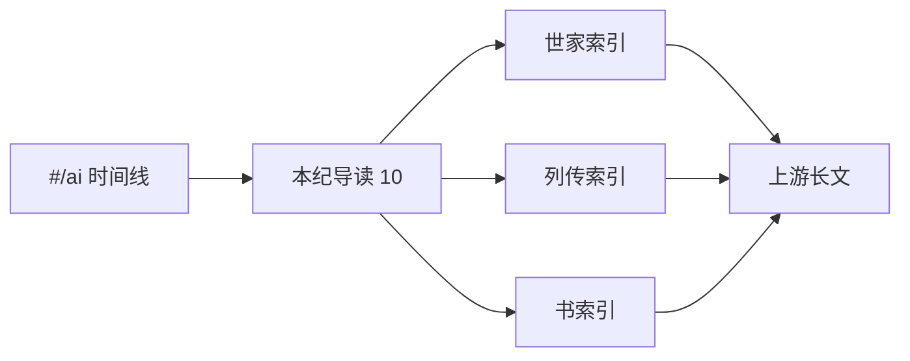

# AI：学习路线与史记导读地图

本主题（`ai` / UI：**AI**）把开源书 [AI 史记](https://zsjunai.github.io/history-of-ai/)（仓库 [zsjunai/history-of-ai](https://github.com/zsjunai/history-of-ai)，[CC BY-SA 4.0](https://creativecommons.org/licenses/by-sa/4.0/)）的**五体结构**接入本站：

| 上游体例 | 站内落点 | 说明 |
|----------|----------|------|
| 表 · 大事年表 | [`#/ai`](#/ai) + `src/ai-timeline-data.js` | **134** 条结构化事件（10 时代），可按类型/重要度浏览 |
| 本纪 · 10 篇 | [`annals/`](./annals/) | 每时代一篇**导读 + 事件表**；长文外链上游 |
| 世家 · 31 篇 | [`houses/00-index`](./houses/00-index.md) | 机构索引 → 上游 |
| 列传 · 23 篇 | [`biographies/00-index`](./biographies/00-index.md) | 人物索引 → 上游 |
| 书 · 25 篇 | [`treatises/00-index`](./treatises/00-index.md) | 专题/国别索引 → 上游 |

> 定位：**可检索的史纲 + 时间线 UI**。结构化年表事件在署名下导入；本纪/世家/列传/书的**长散文不镜像**——用原创中文导读与目录，细节点回上游。衍生数据遵循 CC BY-SA 4.0（见 [ATTRIBUTION](./ATTRIBUTION.md)）。

## 建议路径

1. 打开 [`#/ai`](#/ai)，按时代扫事件；过滤「里程碑 / 论文 / 产品」。
2. 对感兴趣的时代读 [`annals/`](./annals/) 导读（「在争什么」+ 全量表）。
3. 需要机构 / 人物 / 专题细节时，从三个索引跳上游。
4. 与站内 `gpu/`（算力）、`opensource/`（开源生态）交叉阅读。

## 笔记地图

| 篇 | 主题 | 本库 |
|----|------|------|
| — | 路线与署名 | [00-roadmap](./00-roadmap.md) · [ATTRIBUTION](./ATTRIBUTION.md) |
| — | 五体总览 | [structure-overview](./structure-overview.md) |
| 1–10 | 本纪导读 | [annals/](./annals/) |
| 索引 | 世家 / 列传 / 书 | [houses](./houses/00-index.md) · [biographies](./biographies/00-index.md) · [treatises](./treatises/00-index.md) |

## 阅读约定

- 年份与史实以[上游年表](https://zsjunai.github.io/history-of-ai/timeline/)与一手文献为准；发现出入时改站内导读并保留 `sourceUrl`。
- 政策/安全条目只记时间锚与治理动机。
- 新增时代补充：先改 `src/ai-timeline-data.js`（或自上游再导入），再同步对应 `annals/*.md`。
