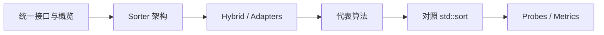

# cpp-sort 学习路线

按 [Morwenn/cpp-sort](https://github.com/Morwenn/cpp-sort)（[Wiki](https://github.com/Morwenn/cpp-sort/wiki)）整理的**渐进中文学习笔记**：先建立「sorter / adapter / probe / metrics」心智模型，再挑代表算法与 `std::sort` 对照。正文为原创消化，**不是**上游文档镜像。

前置建议：已熟悉迭代器半开区间与 `<algorithm>` 排序入门——见 LearnCpp [第 18–19 章](#/note/cpp/learncpp/ch18-19-iterators-dynamic)、[LearnCpp 路线](#/note/cpp/learncpp/00-roadmap)。

## 建议路径

1. **概念总览** → [01 概览](#/note/cpp/cpp-sort/01-overview)：库定位、统一排序接口、与「再造一套 std」的差别  
2. **架构** → [02 Sorter 与库结构](#/note/cpp/cpp-sort/02-sorter-architecture)：函数对象式 sorter、`sorter_facade`、hybrid / 各类 adapter  
3. **算法样本** → [03 代表算法](#/note/cpp/cpp-sort/03-representative-algorithms)：pdq / merge / heap / tim / smooth 等怎么选  
4. **标准对照** → [04 与 std::sort](#/note/cpp/cpp-sort/04-vs-std-sort)：何时用标准库、何时引入 cpp-sort  
5. **进阶（本系列后续可扩）**：disorder probe（预有序度量）→ metrics（比较次数 / 耗时）→ 自写 sorter

## 章节地图

| 章 | 主题 | 笔记 |
|----|------|------|
| 0 | 本路线 | 本页 |
| 1 | 库概览与快速上手直觉 | [01](#/note/cpp/cpp-sort/01-overview) |
| 2 | Sorter 概念与库架构 | [02](#/note/cpp/cpp-sort/02-sorter-architecture) |
| 3 | 若干代表算法 | [03](#/note/cpp/cpp-sort/03-representative-algorithms) |
| 4 | 与 `std::sort` / 标准算法的关系 | [04](#/note/cpp/cpp-sort/04-vs-std-sort) |

## 上游入口

| 资源 | 用途 |
|------|------|
| [仓库 README](https://github.com/Morwenn/cpp-sort) | 安装、特性清单、致谢与来源算法 |
| [Wiki · Quickstart](https://github.com/Morwenn/cpp-sort/wiki/Quickstart) | 最短上手路径 |
| [Wiki · Sorters](https://github.com/Morwenn/cpp-sort/wiki/Sorters) | 算法复杂度与迭代器要求 |
| [Wiki · Sorter adapters](https://github.com/Morwenn/cpp-sort/wiki/Sorter-adapters) | hybrid / indirect / drop_merge 等 |
| [Wiki · Measures of disorder](https://github.com/Morwenn/cpp-sort/wiki/Measures-of-disorder) | 预有序度量（probe） |
| [Wiki · Metrics](https://github.com/Morwenn/cpp-sort/wiki/Metrics) | 包装 sorter 收集比较次数等 |

> 版本提示：1.x 以维护为主；新功能多在要求 C++17+ 的 2.x 线。笔记按概念写，具体 API 以当前 Wiki 为准。

## 站内相关

- [LearnCpp 迭代器与算法](#/note/cpp/learncpp/ch18-19-iterators-dynamic) · [模板](#/note/cpp/learncpp/ch11-overload-templates) · [函数进阶 / lambda](#/note/cpp/learncpp/ch20-advanced-functions)
- 专题短文：[RAII](#/note/cpp/raii-and-ownership)（异常与临时缓冲寿命直觉）
