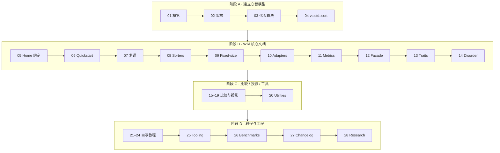

# cpp-sort 学习路线

按 [Morwenn/cpp-sort](https://github.com/Morwenn/cpp-sort) 官方 [Wiki](https://github.com/Morwenn/cpp-sort/wiki)（文档约 2.2.0）整理的**全量中文学习笔记**：先建立「sorter / adapter / probe / metrics」心智模型，再按 Wiki 侧栏逐页消化。正文为原创改写，**不是**英文 Wiki 镜像；代码标识与关键示例保持准确。

前置建议：已熟悉迭代器半开区间与 `<algorithm>` 排序入门——见 LearnCpp [第 18–19 章](#/note/cpp/learncpp/ch18-19-iterators-dynamic)、[LearnCpp 路线](#/note/cpp/learncpp/00-roadmap)。

站内互链一律用 `#/note/cpp/cpp-sort/...`（GitHub Pages 安全的 hash 路由），勿用相对 `.md` 文件路径。

## 建议路径（渐进）

1. **阶段 A（概念）**：01 → 04，建立「何时用这个库」的判断。  
2. **阶段 B（库本体）**：05 → 14，对齐 Wiki「Sorting library」主干。  
3. **阶段 C（配套）**：15 → 20，比较器 / 投影 / utility。  
4. **阶段 D（动手与外围）**：21 → 28，自写 sorter/adapter、工具链、基准、版本门控、研究笔记。

## 章节地图（覆盖全部 Wiki 内容页）

| 章 | 主题 | 笔记 | 对应 Wiki |
|----|------|------|-----------|
| 0 | 本路线 | 本页 | [_Sidebar* 导航结构 |
| 1 | 库概览直觉 | [01](#/note/cpp/cpp-sort/01-overview) | Home / Quickstart（浓缩） |
| 2 | Sorter 与库架构 | [02](#/note/cpp/cpp-sort/02-sorter-architecture) | Quickstart / Adapters（浓缩） |
| 3 | 若干代表算法 | [03](#/note/cpp/cpp-sort/03-representative-algorithms) | Sorters（抽样） |
| 4 | 与 `std::sort` 对照 | [04](#/note/cpp/cpp-sort/04-vs-std-sort) | （站内对照，非 Wiki 页） |
| 5 | 异常 / 确定性 / 配置宏 | [05](#/note/cpp/cpp-sort/05-home-general) | [Home](https://github.com/Morwenn/cpp-sort/wiki/Home) |
| 6 | 快速上手全文消化 | [06](#/note/cpp/cpp-sort/06-quickstart) | [Quickstart](https://github.com/Morwenn/cpp-sort/wiki/Quickstart) |
| 7 | 库术语表 | [07](#/note/cpp/cpp-sort/07-library-nomenclature) | [Library nomenclature](https://github.com/Morwenn/cpp-sort/wiki/Library-nomenclature) |
| 8 | Sorters 族与选型 | [08](#/note/cpp/cpp-sort/08-sorters) | [Sorters](https://github.com/Morwenn/cpp-sort/wiki/Sorters) |
| 9 | 定长 sorter | [09](#/note/cpp/cpp-sort/09-fixed-size-sorters) | [Fixed-size sorters](https://github.com/Morwenn/cpp-sort/wiki/Fixed-size-sorters) |
| 10 | Sorter adapters | [10](#/note/cpp/cpp-sort/10-sorter-adapters) | [Sorter adapters](https://github.com/Morwenn/cpp-sort/wiki/Sorter-adapters) |
| 11 | Metrics | [11](#/note/cpp/cpp-sort/11-metrics) | [Metrics](https://github.com/Morwenn/cpp-sort/wiki/Metrics) |
| 12 | `sorter_facade` | [12](#/note/cpp/cpp-sort/12-sorter-facade) | [Sorter facade](https://github.com/Morwenn/cpp-sort/wiki/Sorter-facade) |
| 13 | Sorter traits | [13](#/note/cpp/cpp-sort/13-sorter-traits) | [Sorter traits](https://github.com/Morwenn/cpp-sort/wiki/Sorter-traits) |
| 14 | 无序度量（probe） | [14](#/note/cpp/cpp-sort/14-measures-of-disorder) | [Measures of disorder](https://github.com/Morwenn/cpp-sort/wiki/Measures-of-disorder) |
| 15 | 比较器与投影总述 | [15](#/note/cpp/cpp-sort/15-comparators-and-projections) | [Comparators and projections](https://github.com/Morwenn/cpp-sort/wiki/Comparators-and-projections) |
| 16 | 内置比较器 | [16](#/note/cpp/cpp-sort/16-comparators) | [Comparators](https://github.com/Morwenn/cpp-sort/wiki/Comparators) |
| 17 | 比较器适配器 | [17](#/note/cpp/cpp-sort/17-comparator-adapters) | [Comparator adapters](https://github.com/Morwenn/cpp-sort/wiki/Comparator-adapters) |
| 18 | 可链式投影 | [18](#/note/cpp/cpp-sort/18-chainable-projections) | [Chainable projections](https://github.com/Morwenn/cpp-sort/wiki/Chainable-projections) |
| 19 | 精化比较 / 投影 | [19](#/note/cpp/cpp-sort/19-refined-functions) | [Refined functions](https://github.com/Morwenn/cpp-sort/wiki/Refined-functions) |
| 20 | 杂项 utilities | [20](#/note/cpp/cpp-sort/20-miscellaneous-utilities) | [Miscellaneous utilities](https://github.com/Morwenn/cpp-sort/wiki/Miscellaneous-utilities) |
| 21 | 教程：写一个 sorter | [21](#/note/cpp/cpp-sort/21-writing-a-sorter) | [Writing a sorter](https://github.com/Morwenn/cpp-sort/wiki/Writing-a-sorter) |
| 22 | 教程：`bubble_sorter` | [22](#/note/cpp/cpp-sort/22-writing-bubble-sorter) | [Writing a bubble_sorter](https://github.com/Morwenn/cpp-sort/wiki/Writing-a-bubble_sorter) |
| 23 | 教程：`randomizing_adapter` | [23](#/note/cpp/cpp-sort/23-writing-randomizing-adapter) | [Writing a randomizing_adapter](https://github.com/Morwenn/cpp-sort/wiki/Writing-a-randomizing_adapter) |
| 24 | 教程：容器感知算法 | [24](#/note/cpp/cpp-sort/24-writing-container-aware) | [Writing a container-aware algorithm](https://github.com/Morwenn/cpp-sort/wiki/Writing-a-container-aware-algorithm) |
| 25 | CMake / Conan 工具 | [25](#/note/cpp/cpp-sort/25-tooling) | [Tooling](https://github.com/Morwenn/cpp-sort/wiki/Tooling) |
| 26 | 基准解读 | [26](#/note/cpp/cpp-sort/26-benchmarks) | [Benchmarks](https://github.com/Morwenn/cpp-sort/wiki/Benchmarks) |
| 27 | C++ 版本特性门控 | [27](#/note/cpp/cpp-sort/27-changelog) | [Changelog](https://github.com/Morwenn/cpp-sort/wiki/Changelog) |
| 28 | 原创研究摘记 | [28](#/note/cpp/cpp-sort/28-original-research) | [Original research](https://github.com/Morwenn/cpp-sort/wiki/Original-research) |

> Wiki 另有 `_Sidebar`（导航）与历史重定向 `Measures-of-presortedness` → `Measures-of-disorder`；内容并入上表 00 / 14，不单独成篇。

## 上游入口

| 资源 | 用途 |
|------|------|
| [仓库 README](https://github.com/Morwenn/cpp-sort) | 安装、特性清单、致谢与来源算法 |
| [Wiki 首页](https://github.com/Morwenn/cpp-sort/wiki) | 官方文档入口 |
| [Releases](https://github.com/Morwenn/cpp-sort/releases) | 完整版本变更（Wiki Changelog 只讲语言门控） |

> 版本提示：1.x 以维护为主；新功能多在要求 C++17+ 的 2.x 线。笔记按概念写，具体 API 以当前 Wiki 为准。

## 站内相关

- [LearnCpp 迭代器与算法](#/note/cpp/learncpp/ch18-19-iterators-dynamic) · [模板](#/note/cpp/learncpp/ch11-overload-templates) · [函数进阶 / lambda](#/note/cpp/learncpp/ch20-advanced-functions)
- [Cherno 路线](#/note/cpp/cherno/00-roadmap)（薄索引）
- 专题短文：[RAII](#/note/cpp/raii-and-ownership)（异常与临时缓冲寿命直觉）
