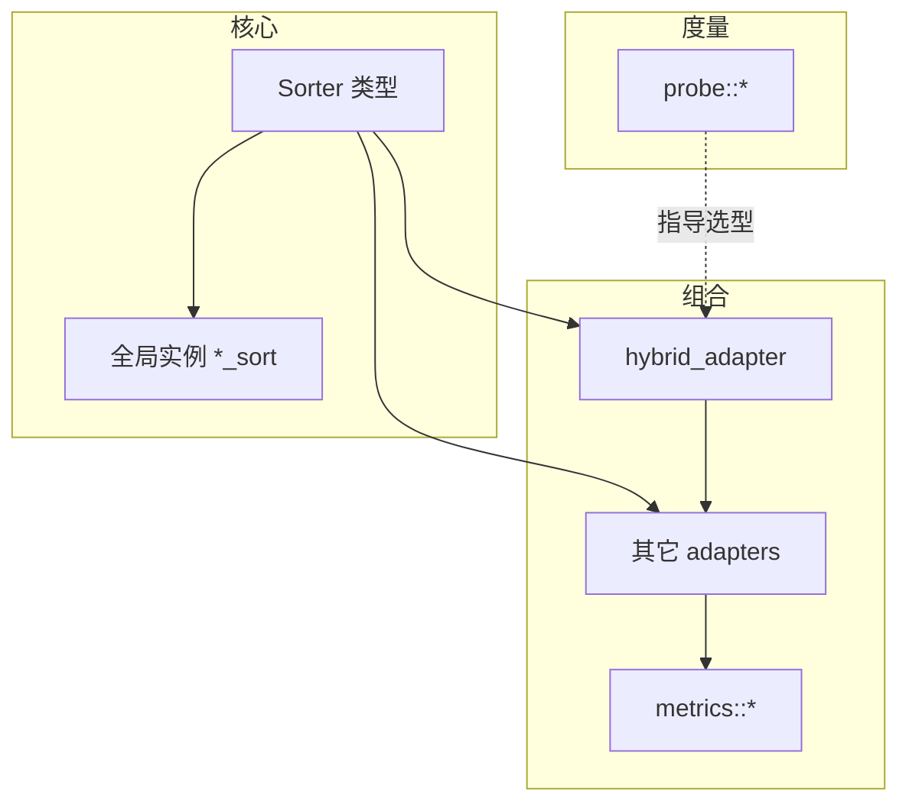

# Sorter 概念与库架构

> 出处：[Wiki Quickstart](https://github.com/Morwenn/cpp-sort/wiki/Quickstart) · [Sorters](https://github.com/Morwenn/cpp-sort/wiki/Sorters) · [Sorter adapters](https://github.com/Morwenn/cpp-sort/wiki/Sorter-adapters)  
> 路线：[00](#/note/cpp/cpp-sort/00-roadmap) · 上一篇：[01 概览](#/note/cpp/cpp-sort/01-overview)

## 为何是函数对象而不是自由函数模板

标准算法常见形态是函数模板；cpp-sort 则把每个算法做成 **sorter 类型 + 可调用实例**。好处主要在**组合**：

1. 整包 overload set 能当作一个值传给泛型函数（数比较次数、做基准测试）。  
2. **Adapter** 以「吃一个 Sorter、再吐出一个 Sorter」的方式叠行为——若只是零散函数模板，这种装饰器模式会别扭得多。  
3. 无状态 sorter 往往还能**退化成函数指针**，方便塞进 C 风格回调或旧接口。

哲学上接近标准库后来的 **Searcher** 对象：构造可带策略参数，调用时走统一接口。

多数官方 sorter 经 **`sorter_facade`** 生成统一调用样板（迭代器对 / range、比较器、投影的合法组合）。自写 sorter 时才需要直接碰 facade；日常用库只要知道「调用形态一致」即可。

## 类型分层（心智模型）



- **比较排序**：接受弱序比较器，通常也接受投影。  
- **类型特化排序**：策略绑在类型上（如某些整数/字符串友好算法），比较器可能不可用。  
- **Fixed-size sorter**：针对极小固定长度序列（排序网络等），另有专用 adapter。

头文件：单算法 `#include <cpp-sort/sorters/xxx_sorter.h>`；或 `#include <cpp-sort/sorters.h>` / `adapters.h` 一把梭（编译量更大）。前向声明可用 `<cpp-sort/fwd.h>`。

## Hybrid：按迭代器类别派发

`hybrid_adapter<S1, S2, ...>` 把多个 sorter 合成一个：根据**被排序序列的迭代器类别**与各 sorter 声明的 `iterator_category` 选实现。同类别有多个候选时，**模板参数列表里靠前**的优先（除非 SFINAE 出局）。

典型配方（与 README 示例同思路）：

```cpp
#include <cpp-sort/adapters.h>
#include <cpp-sort/sorters.h>

using my_sorter = cppsort::hybrid_adapter<
    cppsort::pdq_sorter,   // 随机访问
    cppsort::merge_sorter  // 更弱的迭代器
>;
```

嵌套的 `hybrid_adapter` 会被**拍平**，以便外层看到内层各 sorter 的真实迭代器类别，而不是一个「融合后的」标签。这对「库用户拼策略」很关键：你可以模块化地组装通用排序器。

自写 sorter 若想进 hybrid，需要提供正确的 `iterator_category`，并对不支持的类型用 SFINAE 失败 overload，好让 fallback 有机会接住。

## 常用 Adapter 分类（先认族）

不必背完 Wiki 列表，先按**动机**分桶：

| 动机 | 代表 adapter | 直觉 |
|------|----------------|------|
| 拼策略 | `hybrid_adapter` | 按迭代器（等）选算法 |
| 容器特化 | `container_aware_adapter` | 对 `list` / `forward_list` 用 splice 等专用实现 |
| 少搬大对象 | `indirect_adapter` | 先排迭代器，再按环移动元素 |
| 贵投影 | `schwartz_adapter` | Schwartzian：先算键再排 |
| 变自适应 | `drop_merge_adapter` / `split_adapter` | 额外一遍，使底层算法对某种 disorder 更友好 |
| 稳定化等 | `stable_adapter` 等 | 改变稳定性或其它契约 |
| 异地排 | `out_of_place_adapter` | 拷到连续缓冲再排，再搬回 |

Adapter 通常**存一份**被适配 sorter 的副本，因而也能包有状态的 sorter；多数仍期望 `const operator()`。

## Metrics 与 Probe（架构上的位置）

- **Metrics**：仍是 adapter，但调用后往往返回带 `.value()` 的度量结果（比较次数、运行时间等），而不是「排完就丢」。适合写自己的 micro-benchmark，而不是替代 Google Benchmark 全家桶。  
- **Probe**：实现统一接口的**度量函数对象**，返回整数型 disorder；已排序一般为 0。用来回答「我的数据更像逆序对多，还是 run 碎？」——再去选 *M*-adaptive 算法或包一层 Rem-adaptive adapter。

二者都建立在「sorter 是值、接口统一」之上；若算法只是散落的函数模板，这种横切工具会难写得多。

## 易错点

- **迭代器类别不匹配**：`pdq_sorter` 等只要随机访问；对 `forward_list` 直接调用会失败——用 hybrid、换 merge/quick，或 `out_of_place_adapter`。  
- **稳定 ≠ 包了就稳**：有的 adapter（如 drop-merge 一类）会让结果**不稳定**，即便底层 sorter 稳定。  
- **传迭代器对 vs 传容器**：`container_aware_adapter` 的专用路径通常需要**完整容器**；只传一对迭代器时往往退回通用实现。  
- **异常后状态**：临时缓冲 + 移动元素过程中抛错，不保证强异常安全。

## 练习指引

1. 写一个只接受 `Sorter` 的函数模板，用包装比较器统计比较次数；分别传入 `heap_sort` 与 `merge_sort`。  
2. 构造 `hybrid_adapter<pdq_sorter, merge_sorter>`，对 `vector` 与 `list` 各调用一次。  
3. 阅读任意一个 adapter 的 Wiki 段，记下它对「稳定性 / 最低迭代器」的硬性改写。

下一章：[代表算法](#/note/cpp/cpp-sort/03-representative-algorithms)。
