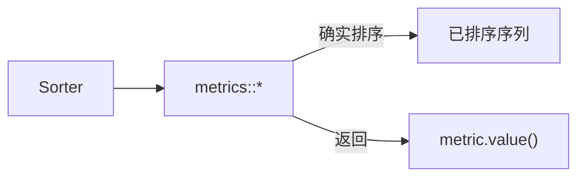

# Metrics：给 Sorter 量一量

> 出处：[Wiki · Metrics](https://github.com/Morwenn/cpp-sort/wiki/Metrics)  
> 路线：[00](#/note/cpp/cpp-sort/00-roadmap) · 架构背景：[02](#/note/cpp/cpp-sort/02-sorter-architecture) · 下一篇：[12 sorter_facade](#/note/cpp/cpp-sort/12-sorter-facade)

**Metrics** 是一类特殊的 [sorter adapter](#/note/cpp/cpp-sort/02-sorter-architecture)：仍然走统一排序接口、**确实会把序列排好**，但调用结果不再是「排完就丢」，而是包着度量值的 `cppsort::utility::metric`。适合自己写微基准或对比两种算法在固定输入上的比较次数，而不是替代 Google Benchmark 全家桶。

> 原创中文消化；API 细节以上游 Wiki / 头文件为准。**所有 metrics 都不是线程安全的。**

## 解剖：比普通 adapter 多什么

| 属性 | 含义 |
|------|------|
| 返回值 | 被适配 sorter 的返回值被换成 `utility::metric<Value, Tag>` |
| `tag_t` | 度量标签类型（通常以 `_tag` 结尾） |
| `metric_t` | 实际返回的 metric 类型别名 |

标签可以是空类型，也可以塞静态元数据；未来库版本可能标准化某些字段。取值一般用 `.value()`。工具头会随各 metrics 头间接包含：`<cpp-sort/utility/metrics_tools.h>`。

命名空间：`cppsort::metrics`。单头或一把梭：

```cpp
#include <cpp-sort/metrics.h>  // 或 metrics/comparisons.h 等
```

## 可用度量

### `comparisons` — 比较次数

```cpp
#include <cpp-sort/metrics/comparisons.h>

template<typename Sorter, typename CountType = std::size_t>
struct comparisons;
```

通过**包装比较器**计数。因此：

- 只对接受比较器的 sorter 有意义；  
- 会绕过「对特定比较器对象特化」的路径；  
- 若被包装比较器被标成无分支，包装层也会**假装**自己无分支（见库的 branchless traits）。

返回：`utility::metric<CountType, comparisons_tag>`。

```cpp
#include <vector>
#include <cpp-sort/metrics/comparisons.h>
#include <cpp-sort/sorters/pdq_sorter.h>

auto metric = cppsort::metrics::comparisons<cppsort::pdq_sorter>{}(vec);
auto n_cmp = metric.value();
```

### `moves` — 移动次数

```cpp
#include <cpp-sort/metrics/moves.h>

template<typename Sorter, typename CountType = std::size_t>
struct moves;
```

统计对象的**移动构造 + 移动赋值**；一次 `swap` 按 **3 次 move** 计。实现思路大致是：建一份会计数的包装元素 `vector`，在上面排完再搬回原集合。含义：

- 包装迭代器会**模仿**原区间的迭代器**类别** → 依赖 category 的行为仍对，依赖**具体迭代器类型**的行为可能失真；  
- 依赖元素类型特化的 sorter，测到的数可能不代表真机上的表现；  
- **必须支持投影**：adapter 会塞投影，把包装类型还原成底层值。

返回：`utility::metric<CountType, moves_tag>`。

### `projections` — 投影调用次数

```cpp
#include <cpp-sort/metrics/projections.h>

template<typename Sorter, typename CountType = std::size_t>
struct projections;
```

包装投影函数来计数；只对接受投影的 sorter 有意义。特化绕过 / 假装无分支的注意点与 `comparisons` 对称。

返回：`utility::metric<CountType, projections_tag>`。

### `running_time` — 墙钟耗时

```cpp
#include <cpp-sort/metrics/running_time.h>

template<
    typename Sorter,
    typename DurationType = typename std::chrono::steady_clock::duration
>
struct running_time;
```

默认用 `steady_clock` 量「排完这段」的时间。返回 `utility::metric<DurationType, running_type_tag>`（标签名以上游头文件为准）。这是粗粒度本地计时，不是严格性能分析工具。

## 心智图



Metrics 建立在「sorter 是值、接口统一」之上——见 [02 架构](#/note/cpp/cpp-sort/02-sorter-architecture)。若只想刻画**数据有多乱**而不是算法开销，用 [probe / 无序度量](#/note/cpp/cpp-sort/14-measures-of-disorder)，二者别混。

## 易错点

1. **非线程安全**：多线程共用同一 metric 实例 / 底层计数会踩。  
2. **`moves` 失真**：类型特化、容器感知路径、真正依赖迭代器类型的优化，测出来可能偏。  
3. **比较器特化被绕过**：`comparisons` 包了一层，专门给 `std::less<>` 开的快路径可能走不到。  
4. **别当生产路径**：每次排序都量一遍没有意义；典型用法是对代表性输入做离线剖析。

## 练习

1. 对同一 `vector`，分别用 `metrics::comparisons` 包 `heap_sorter` 与 `pdq_sorter`，对比 `.value()`。  
2. 给带成员投影的排序加一层 `metrics::projections`，确认投影被调用的次数量级。  
3. 读一眼 `utility::metric` 与 tag 的定义，弄清如何按 tag 区分度量种类。

上一篇（系列前段）：[04 与 std::sort](#/note/cpp/cpp-sort/04-vs-std-sort) · 下一篇：[12 sorter_facade](#/note/cpp/cpp-sort/12-sorter-facade)。
