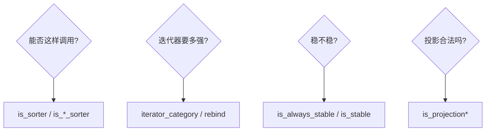

# Sorter traits：描述 Sorter 的元信息

> 出处：[Wiki · Sorter traits](https://github.com/Morwenn/cpp-sort/wiki/Sorter-traits)  
> 头文件：`<cpp-sort/sorter_traits.h>`  
> 上一篇：[12 sorter_facade](#/note/cpp/cpp-sort/12-sorter-facade) · 下一篇：[14 无序度量](#/note/cpp/cpp-sort/14-measures-of-disorder)

这组 traits 回答两类问题：**(1) 这个类型能不能当某种参数组合下的 sorter？(2) 它接受什么迭代器、是否稳定？** 主要用于 SFINAE / 概念式约束，以及 `hybrid_adapter`、`stable_adapter` 等组合件的决策。

## 投影可行性：`is_projection` 族

检查投影能否作用在 range / 迭代器的 `reference` 上；若再给 `Compare`，还会检查「两个投影结果能否拿去比较」。

```cpp
template<typename Projection, typename Range, typename Compare = std::less<>>
struct is_projection;

template<typename Projection, typename Iterator, typename Compare = std::less<>>
struct is_projection_iterator;
```

风格对齐标准库：继承 `true_type` / `false_type`，并有 `_v` 变量模板（`is_projection_v`、`is_projection_iterator_v`）。

## 调用可行性：`is_sorter` 族

按「能否用这些参数调用」细分：

| Trait | 大致含义 |
|-------|----------|
| `is_sorter<S, Range>` | 能对 `Range&` 调用 |
| `is_comparison_sorter<S, Range, Comp>` | 还能吃比较器 |
| `is_projection_sorter<...>` | 还能吃投影 |
| `is_comparison_projection_sorter<...>` | 比较器 + 投影 |

另有 `*_iterator` 变体：检查「一对迭代器」路径。全部带对应 `_v`。写泛型包装（metrics、自己的 adapter）时，用它们裁剪 overload 比手写一长串 `decltype` 干净。

## `sorter_traits`：真相来源

```cpp
template<typename Sorter>
struct sorter_traits;
```

从 `Sorter` 里抽出（若存在）：

- `iterator_category` — 标准迭代器标签之一  
- `is_always_stable` — `true_type` / `false_type`

与标准 traits **不同**：缺哪个成员，`sorter_traits` 里也就**没有**哪个——不会因为缺 `is_always_stable` 就整特化炸编译。因此只声明了 `iterator_category` 的 sorter 仍可进 `hybrid_adapter`。

可对用户自定义 sorter / adapter **特化** `sorter_traits`；有时信息**只存在于特化里**。约定：

- **以 `sorter_traits` 为准**；类内别名只是便捷捷径；  
- 两边都有却不一致，视为错误；  
- 库自身有时完全依赖特化提供信息。

便捷别名：

```cpp
template<typename Sorter>
using iterator_category = typename sorter_traits<Sorter>::iterator_category;

template<typename Sorter>
using is_always_stable = typename sorter_traits<Sorter>::is_always_stable;

template<typename Sorter>
constexpr bool is_always_stable_v = is_always_stable<Sorter>::value;
```

### 迭代器类别注意

Adapter 之后的「结果 sorter」类别**不一定**等于被适配者：例如 `heap_sorter` 只要随机访问，但包进 `out_of_place_adapter` 后可以对前向迭代器工作（先拷到连续缓冲再排）。读文档 / traits 时看的是**组合结果**，不是裸算法名。

### 稳定性：`is_always_stable` vs `is_stable`

- **`is_always_stable`**：无论怎么调用，是否**保证**稳定。Adapter 只有在能证明结果总稳定时才标 `true`；否则标 `false`——即便底层有时稳定。例如 `self_sort_adapter` 无法保证任意容器的 `sort` 都稳定 → `is_always_stable` 为 `false_type`。  
- **`is_stable<Sorter(Args...)>`**：更细——**这一组实参**下是否稳定。默认回退到 `is_always_stable`；多数 adapter 有特化。

```cpp
using sorter = cppsort::self_sort_adapter<cppsort::heap_sorter>;
static_assert(cppsort::is_stable_v<sorter(std::list<int>&)>);  // list::sort 稳定
// vector 或 list 的迭代器对：通常仍为 false
```

`stable_adapter` / `stable_t` 会利用这些信息：已知某调用已稳定时，可避免再套一层 `make_stable`。

## `rebind_iterator_category`

```cpp
template<typename Sorter, typename Category>
struct rebind_iterator_category;
```

得到「算法类似、但声明的迭代器类别**更严**」的 sorter。典型用途：两个 sorter 都标 `forward_iterator_tag`，但其中一个对双向/随机访问更优——把后者 rebind 成 `bidirectional_iterator_tag`，再放进 `hybrid_adapter`，让派发按更细的类别选人：

```cpp
using sorter = cppsort::hybrid_adapter<
    foo_sorter,  // 前向最优
    cppsort::rebind_iterator_category<
        bar_sorter,
        std::bidirectional_iterator_tag
    >
>;
```

**不能** rebind 到比自身更松的类别（编译期错误）。

## `fixed_sorter_traits`

针对 **fixed-size sorter**（模板参数是长度 `N` 的排序网络等）：

```cpp
template<template<std::size_t N> class FixedSizeSorter, typename Indices>
struct fixed_sorter_traits;
```

可特化并暴露：

| 成员 | 含义 |
|------|------|
| `domain` | `std::index_sequence<...>`，有特化的那些 `N`；缺省则假定任意 `N` |
| `iterator_category` | 所有特化都保证支持的类别（个别 `N` 可能更松） |
| `is_always_stable` | 是否每个 `N` 都保证稳定 |

## 选型速查



## 练习

1. 对 `pdq_sorter` 与 `merge_sorter` 打印 / `static_assert` 其 `iterator_category` 与 `is_always_stable_v`。  
2. 构造文中 `hybrid_adapter` + `rebind_iterator_category` 的例子，对 forward / bidirectional 容器各调一次。  
3. 用 `is_stable` 对比 `self_sort_adapter<heap_sorter>` 在 `list&` 与 `vector&` 上的结果。

下一篇：[14 Measures of disorder](#/note/cpp/cpp-sort/14-measures-of-disorder)。
