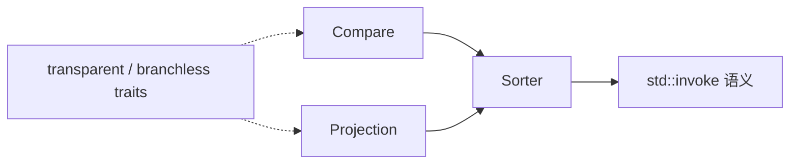

# 比较器与投影：一等公民

> 出处：[Wiki · Comparators and projections](https://github.com/Morwenn/cpp-sort/wiki/Comparators-and-projections)  
> 上一篇：[14 无序度量](#/note/cpp/cpp-sort/14-measures-of-disorder) · 下一篇：[16 具体比较器](#/note/cpp/cpp-sort/16-comparators) · facade 如何补默认：[12](#/note/cpp/cpp-sort/12-sorter-facade)

多数 sorter 接受**比较器**和/或**投影**。库把它们当成与算法同级的积木：有现成比较器、比较器 adapter、投影工具，以及「二者打架时如何消歧」的辅助设施。具体比较器清单见 [16](#/note/cpp/cpp-sort/16-comparators)；本页抓**约定与工具面**。

## Callable + `std::invoke`

凡吃比较 / 投影参数的 API，期望的是标准 **Callable**：任何能作为 `std::invoke` 第一个参数的东西。因此可以直接传：

- 函数指针、函数对象、lambda；  
- **成员指针**、**成员函数指针**（投影里极常见：`&Person::age`）。

用户侧一般**不必**再包一层 `std::mem_fn`。

```cpp
struct Person { std::string name; int age; };

cppsort::pdq_sort(people, std::less{}, &Person::age);
// 或降序年龄：
cppsort::pdq_sort(people, std::greater{}, &Person::age);
```

## 相关工具（杂项 utilities）

| 工具 | 作用 |
|------|------|
| `as_comparison` / `as_projection` | 同一函数对象既像比较又像投影时，**标明角色** |
| `as_function` | 把任意 Callable 收成可用 `()` 调用的对象 |
| `is_probably_branchless_comparison` / `_projection` | 标记「对某类型调用时多半无分支」，供算法选策略 |
| `utility::identity` | 默认投影：原样返回实参 |

这些与 [metrics](#/note/cpp/cpp-sort/11-metrics) 里「包装比较器仍假装无分支」的行为同源：traits 会穿透包装。

歧义示例直觉：某个函数对象重载了一元和二元调用——不标清楚时，facade / 算法可能不知道该当投影还是比较器。`as_comparison(f)` / `as_projection(f)` 就是显式标签。

## Transparent function objects

库提供的比较 / 投影对象，在可能时都做成 **transparent**：

1. 接受任意实参类型（常靠转发引用）；  
2. 完美转发，避免多余拷贝或转换；  
3. 带公开嵌套类型 `is_transparent`（具体别成什么无关紧要，有即可）。

概念来自 C++14 的 `std::less<>` 等：标准关联容器可用它做异质查找（`find` / `lower_bound` 不必先构 key）。**cpp-sort 自己不太依赖**「是否 transparent」，但这让这些对象能无缝塞进 `std::set` 等。

## LWG3031：非 `const` 形参的比较器

Sorter / adapter **允许**比较器以非 `const` 引用接参数，并在「比较器不改坏排序一致性」的前提下正常工作。动机：

- 兼容老代码里的比较器；  
- 少见需求：比较时在对象上记审计信息（最好写在**不影响比较结果**的字段上）。

依据是 [LWG3031](https://wg21.link/LWG3031) 的决议。若同一比较器既有 `const` 又有非 `const` 重载，**两种重载必须返回一致结果**——否则排序语义崩盘（issue 里有反例）。

## 与 facade / traits 的交接

- 没传比较器 / 投影时，行为应如同 `std::less<>` + `identity`（[12](#/note/cpp/cpp-sort/12-sorter-facade)）。  
- 只实现了比较器的 sorter，facade 可把投影烤进比较器。  
- `is_projection` / `is_comparison_sorter` 等（[13](#/note/cpp/cpp-sort/13-sorter-traits)）在编译期检查「这套 Callable 是否配得上这段序列」。



## 投影贵 vs 比较贵

工程上常见两档成本：

| 场景 | 倾向 |
|------|------|
| 投影很贵（深拷贝字符串、正则抽键） | 考虑 Schwartzian / `schwartz_adapter`：先物化键再排 |
| 比较很贵、投影便宜 | 普通「比较器 + 投影」即可；用 [metrics::comparisons / projections](#/note/cpp/cpp-sort/11-metrics) 验证次数 |
| 只要按成员排 | 成员指针投影 + 默认 `std::less<>` |

这与 [02 架构](#/note/cpp/cpp-sort/02-sorter-architecture) 里 adapter 分桶一致：投影/比较器是**策略**，adapter 是**结构**上的二次优化。

## 消歧示例

```cpp
struct Weird {
    // 既可当投影（一元）又可当比较（二元）——少见但合法
    template<typename T>
    auto operator()(T&& x) const -> T&& { return std::forward<T>(x); }

    template<typename T, typename U>
    bool operator()(const T& a, const T& b) const { return a < b; }
};

// 标明角色，避免 overload 选择含糊
cppsort::pdq_sort(v, cppsort::as_comparison(Weird{}));
cppsort::pdq_sort(v, std::less{}, cppsort::as_projection(Weird{}));
```

`as_function` 则适用于「只有成员指针 / 需统一成 `()` 可调用」的泛型胶水，写自己的 probe / metrics 包装时更常见。

## 易错点

1. **投影改写元素**：投影应是只读视角；改元素内容易破坏序。  
2. **比较器改键字段**：即便 LWG3031 允许非 const，改键仍可能违反严格弱序。  
3. **成员函数指针当投影**：注意 `invoke` 对 `const` 成员与对象值类别的要求。  
4. **忘记消歧**：二元+一元都能调的对象，优先 `as_comparison` / `as_projection`。  
5. **transparent 不等于「库会异质优化」**：cpp-sort 不怎么消费 `is_transparent`；好处主要在标准容器互操作。

## 练习

1. 用 `&T::member` 投影排一遍；再换成返回转换键的 lambda。  
2. 对自定义类型写 transparent 的 `less` 风格函数对象，塞进 `std::set` 做异质查找。  
3. 故意传一个同时可一元/二元调用的对象，体验无标签时的编译错误，再用 `as_*` 修好。  
4. 对同一数据集分别量 `metrics::projections` 与裸排序，确认包装开销可接受后再谈优化。

下一篇：[16 Comparators](#/note/cpp/cpp-sort/16-comparators)。
