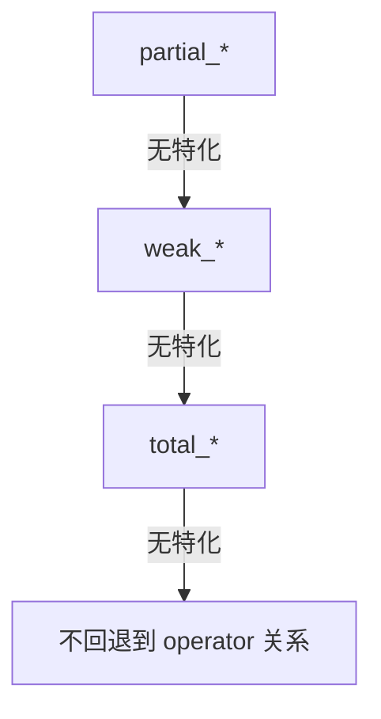

# 内置比较器

> 出处：[Wiki · Comparators](https://github.com/Morwenn/cpp-sort/wiki/Comparators)  
> 上一篇：[15 总述](#/note/cpp/cpp-sort/15-comparators-and-projections) · 系列路线：[00](#/note/cpp/cpp-sort/00-roadmap)

下列比较器可与接受比较参数的 sorter / adapter 共用，均满足库的 **BinaryPredicate** 约定。未做 refined 特化的版本一般是 [transparent](#/note/cpp/cpp-sort/15-comparators-and-projections) 的，可直接用于标准关联容器的异质比较。

多数是 **定制点（customization point）**：对库未内建的类型，可在类型所属命名空间提供同名 ADL 函数扩展行为；回退策略因「全序 / 弱序 / 偏序」家族而异（见下）。设计灵感多来自 [P0100](http://open-std.org/JTC1/SC22/WG21/docs/papers/2015/p0100r1.html)。

## 全序：`total_less` / `total_greater`

```cpp
#include <cpp-sort/comparators/total_less.h>
#include <cpp-sort/comparators/total_greater.h>
```

实现**全序**。内建整数直接用内建关系运算；浮点尽量靠齐 IEEE 754 `totalOrder`（从「更小」到「更大」的直觉序）：

1. $+$quiet NaN  
2. $+$signaling NaN  
3. $+\infty$  
4. 正实数  
5. $+0$  
6. $-0$  
7. 负实数  
8. $-\infty$  
9. $-$signaling NaN  
10. $-$quiet NaN  

现实限制：

- **C++17**：无法区分 quiet / signaling，也无法按 NaN 比特模式细分 → **同号 NaN 视为等价**。  
- **C++20**：在 `__cpp_lib_three_way_comparison` 可用时，借助 `std::strong_order` 正确实现 `totalOrder`（2.1.0 起修好）。

**无 ADL 命中且非内建处理时，不回退到 `operator<`**——全序族整体如此（P0100 理据：避免「看起来能比、其实不是全序」的静默错误）。

对 `std::is_integral` 类型，库视其为 [probably branchless](#/note/cpp/cpp-sort/15-comparators-and-projections)。

## 弱序：`weak_less` / `weak_greater`

```cpp
#include <cpp-sort/comparators/weak_less.h>
#include <cpp-sort/comparators/weak_greater.h>
```

实现**弱序**。整数走全序族；浮点按 Crowl（CppCon 2015）建议的弱序（从更小到更大）：

- 所有 $+$NaN 等价  
- $+\infty$  
- 正实数  
- 所有零等价（$+0$ 与 $-0$）  
- 负实数  
- $-\infty$  
- 所有 $-$NaN 等价  

无原生处理且无 ADL 时，**回退到 `total_*`**（全序也是弱序）。积分类型同样标为 probably branchless。

## 偏序：`partial_less` / `partial_greater`

```cpp
#include <cpp-sort/comparators/partial_less.h>
#include <cpp-sort/comparators/partial_greater.h>
```

实现**偏序**。整数回退弱序族；浮点用**内建关系运算符**（NaN 相关比较按 IEEE / 语言规则，可能「不可比」）。无原生 / 无 ADL 时回退 **`weak_*`**。对 `std::is_arithmetic` 标为 probably branchless。

### 三层回退链（心智图）



选型直觉：需要 NaN / $\pm0$ 可区分且可排序 → 偏 `total_*`；接受「所有 NaN 一堆、零合并」→ `weak_*`；只要「普通 `<` 语义」→ `partial_*`。

## 自然序：`natural_less`

```cpp
#include <cpp-sort/comparators/natural_less.h>
```

[自然排序](https://en.wikipedia.org/wiki/Natural_sort_order)：把数字段按数值比，而不是纯字典序（`file2` &lt; `file10`）。开箱支持两段 **`char` 的前向 range**（含 `std::string`、`std::vector<char>`、`char[]`），用 `<cctype>` 的 `std::isdigit` 认数字。其它字符类型 / locale **目前不管**；上游也倾向最多换成 `<locale>` 的 `isdigit`，而不是大扩特化。

## 大小写不敏感：`case_insensitive_less`

```cpp
#include <cpp-sort/comparators/case_insensitive_less.h>
```

对 `char` / `wchar_t` 的前向 range，先经 `std::ctype::tolower` 再比。两个签名：

```cpp
template<typename T>
bool case_insensitive_less(const T& lhs, const T& rhs);

template<typename T>
bool case_insensitive_less(const T& lhs, const T& rhs, const std::locale& loc);
```

```cpp
// 全局 locale
sort(sequence, case_insensitive_less);

// 经典 C locale
sort(sequence, case_insensitive_less(std::locale::classic()));
```

二元版本内部调用三元版本并传入全局 locale，因此**只定制三元 ADL** 即可同时覆盖二元。该比较器支持 [refined](https://github.com/Morwenn/cpp-sort/wiki/Refined-functions) 特化以换性能。

## 与 sorter 的配合示例

```cpp
#include <vector>
#include <string>
#include <cpp-sort/sorters/pdq_sorter.h>
#include <cpp-sort/comparators/natural_less.h>
#include <cpp-sort/comparators/total_less.h>

void demo(std::vector<std::string>& names, std::vector<double>& xs) {
    cppsort::pdq_sort(names, cppsort::natural_less);
    cppsort::pdq_sort(xs, cppsort::total_less);  // 含 NaN 也可放入全序
}
```

比较器 adapter（取反、投影合成等）在上游 [Comparator adapters](https://github.com/Morwenn/cpp-sort/wiki/Comparator-adapters) 页；与本页工具面合看 [15](#/note/cpp/cpp-sort/15-comparators-and-projections)。

## 易错点

1. **`total_*` 静默失败**：自定义类型没提供 ADL、又期望它走 `operator<`——不会；请显式写定制点或换比较器。  
2. **C++17 浮点 totalOrder 不完整**：同号 NaN 等价；要严格 IEEE 时用 C++20 路径。  
3. **`natural_less` 只认 `char`**：`u16string` / 宽字符别想当然。  
4. **locale 生命周期**：`case_insensitive_less(loc)` 持有 / 依赖 locale 的方式要以头文件为准，避免悬空 facet。  
5. **弱序 / 偏序用于需全序的算法**：少数算法假设可比较任意二元组；NaN 偏序下可能不符合假设——读算法文档。

## 练习

1. 构造含 `NaN`、`+0`、`-0`、$\pm\infty$ 的 `vector<double>`，分别用 `partial_less` / `weak_less` / `total_less`（C++17 vs C++20）观察相对次序。  
2. 对 `{"file1","file10","file2"}` 对比 `std::less<>` 与 `natural_less`。  
3. 为自定义字符串包装类型 ADL 定制 `case_insensitive_less` 三参版本，确认二参调用也走到你的实现。

返回路线：[00 roadmap](#/note/cpp/cpp-sort/00-roadmap) · 度量算法开销：[11 Metrics](#/note/cpp/cpp-sort/11-metrics)。
