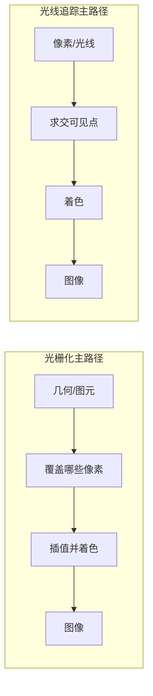
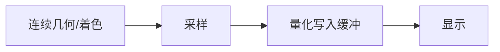
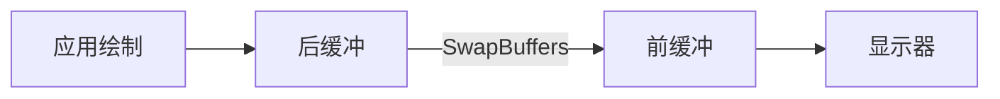
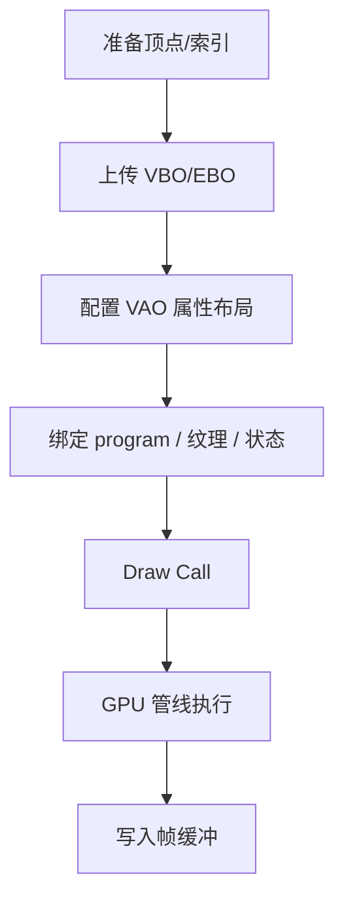
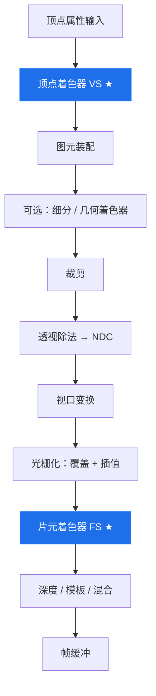
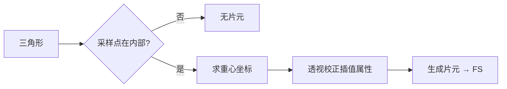
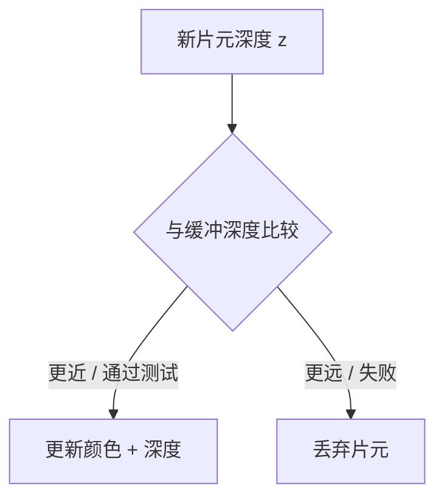
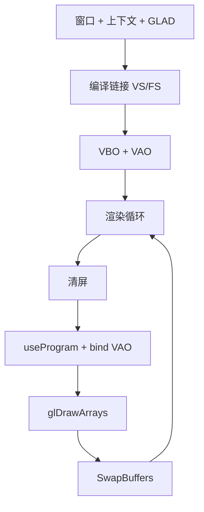
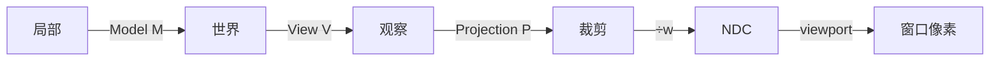

# 第 1 章：图形管线与成像基础

> 学习材料：*Fundamentals of Computer Graphics*（第 5 版，简称 FoCG）中数字图像、光栅化、可见性与管线总览相关章节；[LearnOpenGL — OpenGL](https://learnopengl.com/Getting-started/OpenGL)、[Hello Triangle](https://learnopengl.com/Getting-started/Hello-Triangle) 的实践背景。
> 本章回答：**屏幕上的一张图，从几何描述到像素颜色经历了哪些阶段？每一步在算什么、哪些可编程、哪些由硬件/API 固定？**
> 第 2 章补齐向量与变换工具；第 3 章把可编程阶段落到 OpenGL/GLSL 对象模型。本章只建立**管线心智模型**，不要求一次写完完整工程脚手架。正文穿插 **Mermaid 流程/结构图**（浏览页渲染）。

## 小节地图

| 小节主题 | 内容要点 |
|----------|----------|
| 图形学在解决什么 | 成像目标、合成图像 vs 拍摄 |
| 数字图像与颜色 | 像素、分辨率、通道、线性/gamma 直觉 |
| 帧缓冲与显示 | 颜色/深度/模板、双缓冲、交换与撕裂 |
| 为何是「管线」 | 阶段划分、吞吐、可编程插槽 |
| 应用 → GPU 数据路径 | 顶点、索引、状态、Draw Call |
| 阶段全景表 | VS → 装配 →（可选）→ 裁剪 → 光栅 → FS → 测试/混合 |
| 可编程阶段角色 | 顶点着色器、片元着色器；细分/几何/计算预告 |
| 裁剪、透视除法、视口 | 裁剪空间 → NDC → 窗口坐标 |
| 光栅化深挖 | 覆盖测试、重心坐标、透视校正插值 |
| 可见性与深度 | 画家算法、Z-buffer、精度与近远平面 |
| 正面、绕序与剔除 | winding、背面剔除 |
| 走样与多重采样 | 离散采样问题；MSAA 直觉 |
| 光栅化 vs 光线追踪 | 两种主路径如何分工 |
| Hello Triangle 对照 | 最小闭环如何占满管线骨架 |
| 坐标空间名词表 | 为第 2 章 MVP 铺路 |
| 易错、练习、小结 | 可操作的验证与记忆点 |
| 流程结构图 | 管线总览、CPU→GPU、双缓冲、光栅/深度判定、坐标链 |

相关：[路线图](./00-roadmap.md) · [第 2 章 变换](./ch02-vectors-transforms.md) · [第 3 章 着色器](./ch03-shaders-opengl-basics.md)

## 核心概念

### 图形学在解决什么

FoCG 开篇把计算机图形学定位为：**用计算生成或处理图像**。实时 3D 渲染关心的是：给定相机、几何、材质与光照的描述，尽快在屏幕（或离屏纹理）上得到一幅合理的二维图像。

两条经典计算路径：

| 路径 | 核心问题 | 典型用途 |
|------|----------|----------|
| **光栅化（rasterization）** | 这些三角形覆盖了哪些像素？属性如何插值？ | 游戏、UI、大多数实时引擎 |
| **光线追踪（ray tracing）** | 这条（或这批）光线碰到了什么？ | 离线电影、烘焙、实时混合渲染 |



本章与 LearnOpenGL 入门路径一致，先把**光栅化实时管线**走通。光线追踪只作对比定位，避免概念搅在一起。

### 数字图像：离散的采样结果

输出几乎总是一幅**光栅图像**：矩形网格，每个格子是一个**像素（pixel）**，存放颜色（以及引擎内部还会存深度、模板、G-buffer 通道等）。

关键量：

- **分辨率**：宽 × 高（像素个数）。决定采样密度，也直接拉高片元着色与带宽成本。
- **颜色通道**：常见 `RGB` 或 `RGBA`；每个通道位深（8 bit、10 bit、浮点 HDR 等）决定量化粒度与动态范围。
- **宽高比**：与投影矩阵中的 `aspect` 必须一致，否则圆会变成椭圆（第 2 章展开）。

FoCG 反复强调：真实世界的光场与几何是**连续**的；进入帧缓冲时发生了**采样与量化**。于是出现：

- **走样（aliasing）**：高频细节被过低采样率折成锯齿、摩尔纹。
- **过滤（filtering）**：放大/缩小时如何从邻域估计颜色（纹理章再详谈）。
- **色彩管理 / gamma**：人眼与显示对亮度非线性敏感；「在线性空间里算光，再编码到 sRGB 显示」是现代管线的常见纪律——本章先建立「数字颜色 ≠ 物理辐射照度的直接读数」的警惕即可。



### 帧缓冲：GPU 眼里的「画布」

实时渲染里，可展示的颜色阵列叫**颜色缓冲（color buffer）**。常与之配套：

| 缓冲 | 存什么 | 典型用途 |
|------|--------|----------|
| 颜色缓冲 | 每像素颜色 | 最终画面或离屏 HDR 目标 |
| 深度缓冲（Z-buffer） | 每像素深度 | 遮挡判定 |
| 模板缓冲（stencil） | 每像素整型掩码 | 反射平面、描边、遮罩区域等 |
| （扩展）多渲染目标 MRT | 多份颜色附件 | 延迟渲染 G-buffer |

一组绑定在一起的附件常统称**帧缓冲（framebuffer）**。窗口系统通常提供一份**默认帧缓冲**；LearnOpenGL 后续的 Framebuffers 章节会教你自建 FBO 画到纹理——概念上仍是「同一套管线，换了输出目标」。

**双缓冲**：绘制在**后缓冲**进行，完成后与**前缓冲**交换，避免用户看到半截帧（撕裂/闪烁）。`glfwSwapBuffers` 一类调用就是在推进这一交换。垂直同步（VSync）会限制交换节奏以对齐显示器刷新；关掉则可能更高帧率但更容易撕裂——这是显示侧问题，不是光栅化数学本身。



清屏很重要：每帧通常 `glClear` 颜色（及深度）。只清颜色却开启深度测试，是「第二帧开始什么都看不见」的经典坑。

### 「管线」意味着什么

**图形管线（graphics pipeline）**把「场景描述 → 填充帧缓冲」拆成固定顺序的阶段。好处有三：

1. **语义清晰**：变形、裁剪、光栅、着色、测试各司其职，便于教材与驱动分工。
2. **硬件流水线化**：三角形 A 还在光栅时，三角形 B 的顶点可能已在变换——吞吐靠重叠执行。
3. **可编程插槽稳定**：你不能随意重写整个芯片逻辑，但可以在规定阶段插入着色器程序。

LearnOpenGL 强调现代 OpenGL 是**可编程管线（programmable pipeline）**：core profile 下至少要提供**顶点着色器**与**片元着色器**；旧版固定功能（内置矩阵栈、固定功能光照等）已移除。FoCG 则从算法角度描述同一条链：即便用软件光栅器实现，阶段划分依然相似——OpenGL 只是这条链的一种工业接口。

### 应用到达 GPU：CPU 侧职责

一次成功的绘制，CPU（应用）通常做完这些事：

1. **准备几何**：顶点属性（位置、法线、UV、颜色、切线……）与可选**索引数组**。
2. **上传缓冲**：OpenGL 中进入 VBO / EBO 等 GPU 缓冲对象；标 `STATIC`/`DYNAMIC` 等使用提示。
3. **描述布局**：VAO 记录「location 0 是 3 个 float、stride 多少、偏移多少」。
4. **配置绘制状态**：当前 program、纹理绑定、混合/深度/剔除开关、视口矩形等。
5. **发出 Draw Call**：`glDrawArrays` / `glDrawElements`（以及实例化等变体）。



Draw Call 之后，主力计算在 GPU：按阶段消耗顶点与图元，最终可能改写帧缓冲。CPU 与 GPU 之间还有命令队列与同步问题（栅栏、等待下一帧）；入门阶段先记住——**「调用返回」不等于「像素已经画完」**，但教程代码往往在帧末交换缓冲时自然同步。

索引的意义：共享顶点（位置相同且属性相同）可降内存与 VS 调用次数；立方体若每角法线/UV 不同，则不能盲目共享，需在「拓扑共享」与「属性唯一性」之间权衡。

## 阶段全景

下面按**教学逻辑顺序**列出。真实硬件可能合并阶段、重排工作、或做早期深度测试（Early-Z）等优化；概念学习时仍建议按此表建立顺序感。



图中 ★ / 蓝色节点为入门必写的**可编程**阶段；其余多为固定功能（加状态开关）。

| 阶段 | 输入 → 输出（直觉） | 可编程？ | 入门时必须理解？ |
|------|---------------------|----------|------------------|
| 顶点拉取 / 装配输入 | 缓冲中的属性 → 每顶点输入寄存器 | 固定（布局由你配） | 是 |
| **顶点着色器 VS** | 每顶点 → `gl_Position` + 输出 varyings | **是（必写）** | 是 |
| 图元装配 | 顶点流 → 点 / 线 / 三角形 | 固定 | 是 |
| 曲面细分（可选） | 面片 → 更密图元 | 可选可编程 | 否（预告） |
| 几何着色器（可选） | 图元 → 零或多图元 | 可选可编程 | 否（预告） |
| 裁剪 | 裁剪体外部分被切掉 | 固定 | 是（现象级） |
| 透视除法 | 齐次坐标 → NDC | 固定 | 是 |
| 视口变换 | NDC → 窗口坐标 | 固定（参数可配） | 是 |
| 光栅化 | 图元 → 片元（覆盖 + 插值） | 固定 | 是 |
| **片元着色器 FS** | 每片元 → 颜色（可改深度等） | **是（必写）** | 是 |
| 逐片元测试与混合 | 深度/模板/alpha → 是否写入、如何与原色合成 | 多为固定功能 + 状态 | 是（深度优先） |

**片元（fragment）≠ 最终屏幕像素。** 片元是「对着色器而言的一次候选写回」：可被深度/模板测试丢弃；多重采样下同一像素可有多个采样点；半透明混合时同一像素可累积多次 FS 结果。口语里说「像素着色器」往往指 FS，但精确术语请用片元。

### 顶点着色器：每顶点一次

VS 的契约（OpenGL 视角）：

- **输入**：你启用的顶点属性（`layout(location=...) in`）。
- **必做输出**：裁剪空间齐次坐标 `gl_Position`（四维）。
- **可选输出**：颜色、UV、世界空间法线等 `out` 变量，供后续插值进 FS。

VS **看不到**三角形邻域（除非用额外技巧）；它是「流式、逐顶点」的。把 MVP 乘在 VS 里，是 LearnOpenGL 入门的标准做法——数学意义见第 2 章。

### 图元装配、裁剪、透视除法、视口

**图元装配**按绘制模式把顶点收成点、线段或三角形（以及邻接等变体）。三角形有**绕序（winding）**：屏幕上呈顺时针还是逆时针，用于判定正面（配合 `glFrontFace`）。

**裁剪（clipping）**在裁剪空间进行：落在由 `gl_Position` 的齐次不等式所定义的裁剪体积之外的部分被切开或丢弃。你「把物体放到相机后面」却仍能看见怪异残片时，有时与近平面裁剪、W 符号有关。

**透视除法**：\((x,y,z,w) \mapsto (x/w,\,y/w,\,z/w)\)，得到 **NDC（Normalized Device Coordinates）**。OpenGL 传统上 NDC 各分量约在 \([-1,1]\)（以可用范围为准）。除法之后才谈「屏幕上的位置」——因此 VS 绝不是在写像素坐标。

**视口变换**把 NDC 的 \(x,y\)（及深度映射）线性映到窗口像素坐标与深度缓冲范围，由 `glViewport` 与深度范围状态控制。窗口缩放下忘记更新视口，画面会挤在角落或拉伸错乱。

### 片元着色器：每片元一次

FS 拿到插值后的 `in` 变量，以及若干内置量（如 `gl_FragCoord`），算出输出颜色（core profile 通常写到 `out vec4 FragColor` 或绑定的绘制缓冲）。它可以：

- 采样纹理、算光照、做后处理式的屏幕效果（若输入是全屏三角形）；
- 调用 `discard` 丢掉片元（镂空、alpha test 风格）；
- 在允许时改写深度（谨慎：常关闭 Early-Z 优化）。

FS **默认不知道**整三角的三个原始顶点（除非你显式传）；它看到的是插值结果。

## 光栅化深挖

光栅化要回答两个问题：

1. **覆盖（coverage）**：哪些采样点落在图元内部？
2. **插值（interpolation）**：顶点属性如何赋给内部片元？



### 覆盖测试

对三角形，常用规则是：采样点（常取像素中心，MSAA 则为多个子采样点）是否在三边同一侧。边界情况需要**填充约定（fill rule）**，避免相邻三角形共享边时出现「双写」或「漏缝」——API/硬件有确定规则，入门只需知道：共边接缝闪烁有时来自深度精度，有时来自几何没共顶点。

### 重心坐标

三角形内任一点可写为顶点位置的凸组合：

\[
\mathbf{p} = \alpha\mathbf{p}_0 + \beta\mathbf{p}_1 + \gamma\mathbf{p}_2,
\quad \alpha+\beta+\gamma=1,\quad \alpha,\beta,\gamma\ge 0
\]

\((\alpha,\beta,\gamma)\) 即**重心坐标（barycentric coordinates）**。属性 \(\phi\)（颜色、UV 等）在仿射意义下同样插值：

\[
\phi(\mathbf{p}) = \alpha\phi_0 + \beta\phi_1 + \gamma\phi_2
\]

屏幕空间里直接对 \(\alpha,\beta,\gamma\) 做线性插值，对**透视投影下的某些属性并不正确**。

### 透视校正插值

透视投影后，屏幕上的均匀步进对应眼睛空间里的非均匀步进。对纹理坐标等属性，正确做法的核心思想是：对 \(\phi/w\) 与 \(1/w\) 一类量在屏幕空间插值，再恢复 \(\phi\)（FoCG 光栅化章节有完整推导）。症状级记忆：

- **未校正**：近大远小的四边形上，纹理「挤」在远处或呈明显非线性扭曲。
- **硬件默认**：现代 GPU 对 varying 做透视校正；你在软件光栅器里自己插值时必须显式处理。

LearnOpenGL 入门很少手写校正，因为插值由光栅化固定阶段完成；但当你在 FS 里「用屏幕 UV 反推射线」或自写 CPU 光栅时，这个差别会立刻冒出来。

### 线与点

点、宽线有自己的光栅规则（点大小、线宽、是否抗锯齿）。教学与游戏主路径以**三角形网格**为主；调试时可用线框模式观察拓扑，但线框不是物理材质。

## 可见性：谁挡住了谁

### 画家算法

从远到近依次绘制，近景覆盖远景。优点是半透明「背到前」混合自然；缺点是全局排序贵、相交物体难处理、动态场景不友好。UI 与 2D 有时仍在用简化版分层。

### Z-buffer（深度缓冲）

实时 3D 主流：

1. 每像素保存当前最近深度值。
2. 新片元深度与之比较（`GL_LESS` 等比较函数可配）。
3. 若通过，更新颜色与深度；否则丢弃该片元。



不透明物体大致可**任意顺序**提交（仍有 Overdraw 性能问题）。半透明则通常需要额外策略：排序、加权 OIT、或先画不透明再画透明等——本章先掌握不透明路径。

深度值来自变换后的 \(z\)（经透视与深度映射）。透视投影下 NDC/窗口深度往往**非线性**：近处分辨率高、远处挤在一起。于是：

- **远平面过远**或**近平面过近**都会恶化深度精度；
- 共面或几乎共面的三角形会**Z-fighting**（闪烁）；
- 阴影映射里的「痤疮」也与深度精度/偏置相关（进阶章）。

```cpp
glEnable(GL_DEPTH_TEST);
glClear(GL_COLOR_BUFFER_BIT | GL_DEPTH_BUFFER_BIT);
// 绘制不透明几何……
```

### 早期深度测试（概念）

若 FS 不改深度且满足若干条件，硬件可能在 FS 之前做深度测试，失败则跳过昂贵着色——称为 Early-Z。`discard`、修改 `gl_FragDepth`、某些混合配置会干扰这一优化。入门不必会调优，但要知道「片元着色器不一定对每个覆盖采样都执行」。

## 正面、绕序与背面剔除

封闭网格通常只需要画朝向相机的一面。OpenGL 可用绕序定义正面，并启用背面剔除：

```cpp
glEnable(GL_CULL_FACE);
glCullFace(GL_BACK);
glFrontFace(GL_CCW); // 默认常见：逆时针为正面（在窗口坐标下）
```

若模型导出时绕序与假设相反，或你用了会翻转绕序的负缩放，结果是「模型消失」或只看见内壁。调试步骤：先关剔除确认几何还在，再修正绕序或 `glFrontFace`。

## 走样、过滤与多重采样（导论）

锯齿来自「二值覆盖 + 不足采样」。常见缓解：

| 手段 | 直觉 |
|------|------|
| 超采样 / MSAA | 像素内多个覆盖采样，解析度更高再解析到颜色 |
| 屏幕空间抗锯齿（FXAA/TAA 等） | 后处理估计边缘；TAA 还用历史帧 |
| 纹理过滤与各向异性 | 缩小纹理时避免闪烁与摩尔纹 |

MSAA 主要平滑**几何边缘**；对着色器内部高频（镜面高光闪烁、阴影锯齿）帮助有限，那些要靠别处的过滤或更专门的算法。FoCG 把走样放在信号采样框架里讲；LearnOpenGL 则在 Advanced OpenGL 里给 MSAA 的 API 开关——先接受「离散覆盖必然有走样」，再按需打开抗锯齿。

## 光栅化 vs 光线追踪（定位）

| | 光栅化管线 | 光线追踪 |
|--|------------|----------|
| 组织方式 | 图元驱动：推到屏幕 | 光线驱动：从像素（或光线）拉场景 |
| 可见性 | Z-buffer / 层次等 | 求交最近命中（可加加速结构） |
| 硬阴影、反射、折射 | 需额外技巧或近似 | 路径更自然，成本高 |
| 实时现状 | 仍然是主路径 | 常与光栅混合（反射、软阴影、GI 探针等） |

入门课先把三角形送进帧缓冲画对；混合渲染是后续课题。

## LearnOpenGL 视角：Hello Triangle 如何占满骨架

教程的第一三角形刻意砍掉 MVP、相机、纹理与光照，但**阶段骨架齐全**：

1. 创建窗口与 OpenGL 上下文；加载函数指针（GLAD 等）。
2. 编译链接最小 VS/FS 成 program。
3. 把三个顶点（常已在 NDC）塞进 VBO，用 VAO 记录 `location = 0` 的 `vec3` 布局。
4. 渲染循环：清屏 → `glUseProgram` → 绑 VAO → `glDrawArrays(GL_TRIANGLES, 0, 3)` → 交换缓冲。
5. VS 写 `gl_Position = vec4(aPos, 1.0)`；FS 输出常数色或 varying 色。



对照管线表：VS、装配、（几乎不做裁剪）、透视除法（\(w=1\) 时平凡）、视口、光栅、FS、写颜色缓冲——全部发生。你后面学的每一项（矩阵、纹理、光照、FBO）都是在**同一骨架上填数据与状态**，而不是另起炉灶。

```cpp
// 概念示意：一次绘制（省略错误检查与窗口）
glClear(GL_COLOR_BUFFER_BIT);
glUseProgram(program);
glBindVertexArray(vao);
glDrawArrays(GL_TRIANGLES, 0, 3);
```

```glsl
// 最小顶点着色器：输入已在 NDC
#version 330 core
layout (location = 0) in vec3 aPos;
void main() {
    gl_Position = vec4(aPos, 1.0);
}
```

```glsl
// 最小片元着色器：常数颜色
#version 330 core
out vec4 FragColor;
void main() {
    FragColor = vec4(0.2, 0.7, 0.9, 1.0);
}
```

把 FS 改成依赖 `gl_FragCoord.xy` 的渐变，可直观感到：**FS 按片元（窗口坐标相关）执行**，而不是「整个三角形调一次」。

```glsl
#version 330 core
out vec4 FragColor;
void main() {
    vec2 uv = gl_FragCoord.xy; // 窗口像素坐标（原点惯例在左下）
    FragColor = vec4(fract(uv.x / 40.0), fract(uv.y / 40.0), 0.4, 1.0);
}
```

索引版三角形（两个顶点共享）只是把 `glDrawArrays` 换成 `glDrawElements`，并让 VAO 附带 EBO——管线阶段不变，只是装配时按索引取顶点。细节对象模型见[第 3 章](./ch03-shaders-opengl-basics.md)。

## FoCG 视角补充：把「成像」说清楚

FoCG 习惯从**针孔相机与胶片**建立直觉：场景中的辐射经光学系统落到像平面，再被感光元件采样。实时光栅化用**投影矩阵 + 光栅覆盖**模拟「哪些场景点影响哪些像素」，而不是逐步模拟光子。因此：

- **几何阶段**近似「把三维点投到像平面」；
- **着色阶段**近似「该点反射/发射了多少光进入相机」——入门时常简化成经验模型（Lambert、Phong），进阶再到 PBR（见 [`../pbr-brdf-overview.md`](../pbr-brdf-overview.md)）；
- **可见性**决定「胶片上这一点看见的是前表面还是被挡住」。

用这套语言回看管线表，不会觉得 API 名词是孤岛：它们都是在实现同一条成像故事的不同段落。

## 坐标空间名词表（预告）

矩阵细节属第 2 章，但名称必须先熟：

| 空间 | 含义（直觉） | 谁产生 |
|------|----------------|--------|
| 局部 / 模型 | 网格自身坐标 | 建模软件 / 资产 |
| 世界 | 场景共用坐标 | 模型矩阵 \(M\) |
| 观察 / 视图 / 相机 | 以相机为原点 | 视图矩阵 \(V\) |
| 裁剪 | VS 输出的齐次坐标 | 投影矩阵 \(P\) 作用后 |
| NDC | 透视除法后的规范化设备坐标 | 固定阶段 |
| 屏幕 / 窗口 | 像素坐标 | 视口变换 |



LearnOpenGL「Coordinate Systems」与 FoCG 的 viewing / projection 讲的是同一条链：前者给 GLM/API 用法，后者给几何含义。黑屏时用「物体是否还在 NDC 立方体里」作快速心理检查非常有效。

## 语法与 API 锚点（本章够用的最小集）

完整对象生命周期归第 3 章；这里只钉几个与管线强相关的开关：

```cpp
glViewport(0, 0, width, height);          // NDC → 窗口
glEnable(GL_DEPTH_TEST);                  // 开启 Z-buffer 测试
glEnable(GL_CULL_FACE);                   // 背面剔除（可选）
glClearColor(0.08f, 0.09f, 0.12f, 1.0f);  // 清屏色
glClear(GL_COLOR_BUFFER_BIT | GL_DEPTH_BUFFER_BIT);
```

绘制模式与图元拓扑：

| 模式（示意） | 含义 |
|--------------|------|
| `GL_TRIANGLES` | 每 3 个顶点一个三角形 |
| `GL_TRIANGLE_STRIP` | 带状复用顶点 |
| `GL_LINES` / `GL_POINTS` | 调试线框/点云常用 |

选择错误的模式会得到「三角面变成乱线」之类现象——先怀疑拓扑，再怀疑着色器。

## 易错点

- **把 FS 当成「每个三角形调用一次」**：它按片元（采样）执行；同一像素可能多次；Early-Z / `discard` 会影响实际调用次数。
- **以为 `gl_Position` 是像素坐标**：它是**裁剪空间齐次坐标**；像素位置在透视除法与视口之后才确定。
- **\(w\) 与裁剪**：错误的投影或把手写 NDC 与裁剪空间混用，会导致全部被裁掉或透视畸变怪异。
- **绕序 / 剔除**：开启 `GL_CULL_FACE` 后模型消失，优先检查 winding 与相机是否在「里面」。
- **深度未清或未开**：遮挡关系错乱，或残留上一帧深度。
- **视口与窗口大小不一致**：最小化/拖拽窗口后变形或只更新一角。
- **CPU 状态机绑错对象**：VAO/VBO/program 绑错时常静默黑屏——用「NDC 硬编码三角形 + 常数色 FS」做最小复现。
- **把走样全怪到「模型不够细」**：边缘锯齿首先是采样问题；加密网格不能替代抗锯齿与过滤。
- **半透明直接当不透明画**：无排序的 alpha 混合结果依赖绘制顺序，难一次「看对」。

## 练习指引

- **管线填空**：对照 Hello Triangle，在纸上画出：VBO 字节 → 属性指针 → VS → 装配 →（裁剪/除法/视口）→ 光栅 → FS → 颜色缓冲 → Swap。用星号标出可编程步骤。
- **绕序实验**：反转三顶点顺序，打开/关闭 `GL_CULL_FACE`，记录可见性；改 `glFrontFace` 再试。
- **片元坐标**：用 `gl_FragCoord` 画棋盘或径向渐变；改窗口大小观察是否跟随像素。
- **深度直觉**：画两个部分重叠的三角形，赋不同深度（或经简单平移），开关 `GL_DEPTH_TEST` 对比。
- **裁剪现象**：把 NDC 三角形整体平移到 \(x>1\) 之外，观察完全消失；只移出一半，观察被切边（若你用的是裁剪空间输出）。
- **FoCG 五句复述**（不看笔记写）：覆盖测试、重心插值、透视校正、Z-buffer、光栅化与光线追踪的分工。
- **预习第 2 章**：复习向量点积/叉积与 \(4\times4\) 矩阵乘法；尝试说明为何平移需要齐次坐标。

## 小结

- 实时主路径是**光栅化管线**：顶点处理 → 图元 → 裁剪/NDC/视口 → 光栅 → 片元处理 → 测试/混合 → 帧缓冲 → 显示。
- **数字图像是采样结果**；帧缓冲是 GPU 的画布；双缓冲服务显示完整性。
- **VS / FS** 是现代管线必填的可编程核心；裁剪、光栅、深度测试等多为固定功能（加状态开关）。
- 光栅化解决**覆盖**与**属性插值**（重心 + 透视校正）；**Z-buffer** 解决多数不透明遮挡。
- 绕序与背面剔除影响「看不见」类 bug；走样来自离散采样，需抗锯齿与过滤手段。
- Hello Triangle 已是完整闭环；后续章节只在同一骨架上加入变换、纹理、光照与离屏目标。
