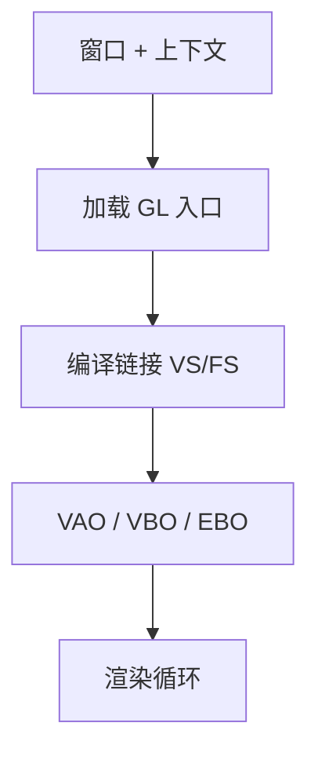
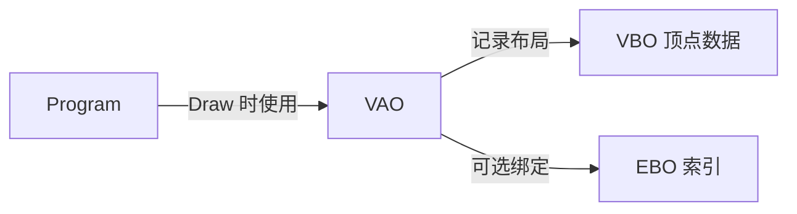
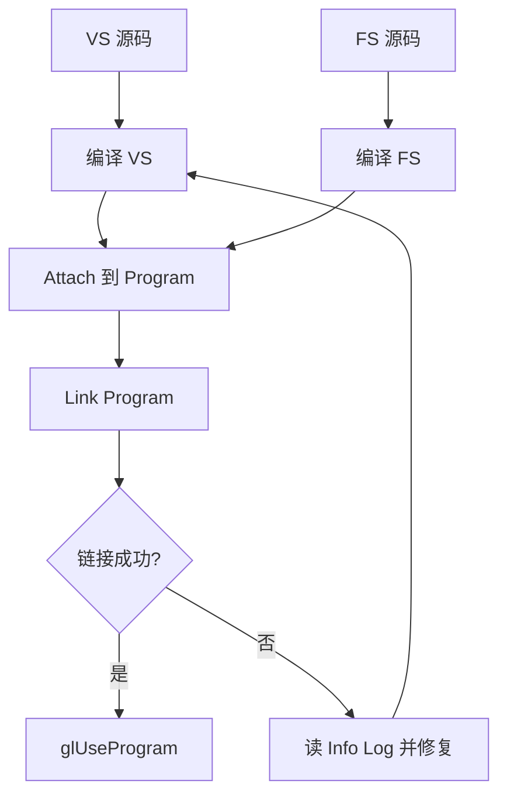
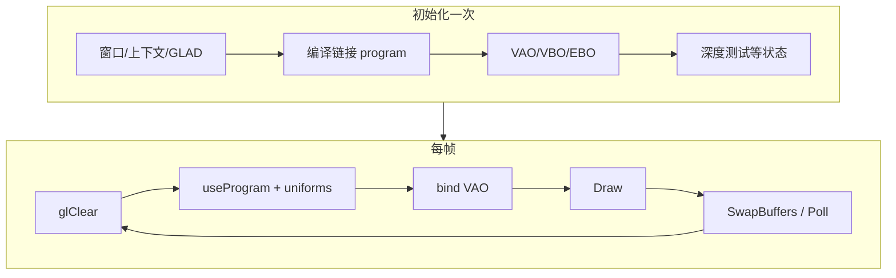

# 第 3 章：着色器与 OpenGL 基础

> 学习材料：[LearnOpenGL — Hello Triangle / Shaders](https://learnopengl.com/Getting-started/Hello-Triangle)；FoCG 中可编程着色阶段的角色定位。
> 本章把第 1 章的管线骨架与第 2 章的 MVP **落到可运行的 OpenGL/GLSL 心智模型**：对象、状态、编译链接、属性、uniform、varying 插值。

## 小节地图

| 小节主题 | 内容要点 |
|----------|----------|
| 现代 OpenGL 画像 | 核心剖面、函数加载、状态机 |
| 对象与绑定 | VAO / VBO / EBO / Program / Texture |
| 顶点数据布局 | `attrib pointer`、stride、归一化 |
| 着色器编译链接 | 编译 → 附加 → 链接 → 使用；日志 |
| GLSL 基础 | 类型、qualifier、`in`/`out`/`uniform` |
| 插值与接口块直觉 | VS → FS 的 varying |
| Uniform 与 CPU 通信 | location、`glUniform*`、UBO 预告 |
| 最小完整路径 | 从缓冲到像素的清单式步骤 |
| 调试黑屏 | 系统化排查顺序 |
| 流程结构图 | 着色器编译链接；对象关系；渲染循环 |

相关：[第 1 章 管线](./ch01-graphics-pipeline.md) · [第 2 章 变换](./ch02-vectors-transforms.md) · [路线图](./00-roadmap.md) · [PBR 速览](../pbr-brdf-overview.md)

## 核心概念

### 核心剖面与「你必须自己做的事」

现代 OpenGL（教程常用 **3.3+ core**）不再提供固定功能管线的便捷路径：没有内置的 `glVertex3f` 立即模式，也没有固定功能光照。你需要：

1. 创建窗口与 **OpenGL 上下文**（GLFW 等）。
2. 加载函数指针（GLAD / gl3w 等）——驱动入口不会凭空出现。
3. 自己写 VS/FS，编译链接成 **program**。
4. 用缓冲对象提供顶点，用 VAO 记录属性配置。
5. 在渲染循环中清屏、绑定、更新 uniform、draw、交换缓冲。



FoCG 把着色器描述为管线上的**可编程钩子**：硬件仍负责光栅与测试，算法的外观与变形由你写的程序决定。LearnOpenGL 则把钩子变成一行行可粘贴的 GLSL——两者合读：理论知边界，实践知 API。

### 状态机思维

OpenGL 是**状态机**：`glBind*`、`glUseProgram`、`glEnable` 改变「当前状态」，后续命令吃当前状态。后果：

- 绑错 VAO / 用错 program，表现为黑屏或错网格，而不是立刻异常。
- 封装时常见模式：RAII 或显式「绑定 → 操作 →（可选）解绑」；引擎层往往再包一层避免全局状态泄漏。

### 三大缓冲相关对象

| 对象 | 角色 |
|------|------|
| **VBO**（Vertex Buffer Object） | GPU 上的顶点属性数组（位置、法线、UV…） |
| **EBO/IBO**（Element / Index Buffer） | 索引，复用顶点，组成三角形 |
| **VAO**（Vertex Array Object） | 记住「如何解释 VBO」：属性 location、格式、stride、是否带 EBO |



Core profile 下，**绘制前绑定 VAO 几乎是必需习惯**。配置属性时：先绑 VAO，再绑 VBO，再 `glVertexAttribPointer` + `glEnableVertexAttribArray`；若有索引，在 VAO 仍绑定时装好 EBO。

```cpp
// 布局示意：位置(3) + UV(2)，交错数组
glBindVertexArray(vao);
glBindBuffer(GL_ARRAY_BUFFER, vbo);
glBufferData(GL_ARRAY_BUFFER, sizeof(vertices), vertices, GL_STATIC_DRAW);

glBindBuffer(GL_ELEMENT_ARRAY_BUFFER, ebo);
glBufferData(GL_ELEMENT_ARRAY_BUFFER, sizeof(indices), indices, GL_STATIC_DRAW);

const GLsizei stride = 5 * sizeof(float);
glEnableVertexAttribArray(0);
glVertexAttribPointer(0, 3, GL_FLOAT, GL_FALSE, stride, (void*)0);
glEnableVertexAttribArray(1);
glVertexAttribPointer(1, 2, GL_FLOAT, GL_FALSE, stride, (void*)(3 * sizeof(float)));
```

`stride` 是从一个顶点到下一个顶点的字节距；偏移是属性在顶点内的起点。交错（interleaved）布局对缓存友好，是教程默认。

### 着色器程序生命周期

1. `glCreateShader(type)` → 提供源码 → `glCompileShader`
2. 检查 `GL_COMPILE_STATUS`，失败则读 info log
3. `glCreateProgram` → `glAttachShader` → `glLinkProgram`
4. 检查 `GL_LINK_STATUS`
5. 链接成功后可 `glDeleteShader`（已编进 program）
6. 渲染时 `glUseProgram(program)`



两个阶段都要查错误：只查编译或只查链接都会漏问题。链接阶段还会做 VS/FS 之间 `in`/`out` 名字与类型的匹配（location 显式更稳妥）。

### GLSL 速写

GLSL 语法类 C，但有向量/矩阵类型与图形 qualifier。

| Qualifier | 含义 |
|-----------|------|
| `in` | 阶段输入（VS：顶点属性；FS：来自 VS 的插值结果） |
| `out` | 阶段输出（VS：传给后续；FS：通常是颜色） |
| `uniform` | 绘制调用间恒定、CPU 可写的全局参数 |
| `layout(location = n)` | 显式属性/输出位置，减少查询 |

```glsl
#version 330 core
layout (location = 0) in vec3 aPos;
layout (location = 1) in vec2 aUV;

uniform mat4 mvp;

out vec2 vUV;

void main() {
    vUV = aUV;
    gl_Position = mvp * vec4(aPos, 1.0);
}
```

```glsl
#version 330 core
in vec2 vUV;
uniform sampler2D uTex;
out vec4 FragColor;

void main() {
    FragColor = texture(uTex, vUV);
}
```

**插值**：光栅化阶段对 VS 的 `out` 做（透视校正）插值，FS 的同名 `in` 拿到的是当前片元处的值。这是第 1 章「属性插值」的可编程接口。

内置变量：`gl_Position`（VS 必写裁剪空间位置）、`gl_FragCoord`（FS 窗口坐标相关）等。精度限定符在 GL ES / WebGL 更敏感；桌面 GL 教程常省略。

### Uniform：CPU → GPU 的旋钮

```cpp
GLint loc = glGetUniformLocation(program, "mvp");
glUseProgram(program); // 先 use 再设 uniform（或用 DSA 风格扩展，视版本）
glUniformMatrix4fv(loc, 1, GL_FALSE, glm::value_ptr(mvp));
```

- `GL_FALSE`：矩阵已是列主；不要再让 API 转置（与 GLM 一致）。
- location 为 `-1` 表示优化掉或名字错误——设了也无效。
- 每帧变化的矩阵、时间、相机位置都走 uniform；大块数据日后再学 **UBO / SSBO**。

### 纹理（仅接口位）

纹理是独立对象：上传图像、设过滤/环绕、绑到纹理单元、`sampler2D` uniform 指定单元编号。细节留给「纹理」专章；本章只需知道：**FS 采样纹理是片元着色器最常见的工作之一**，而 UV 通常来自顶点属性插值。

## 最小完整渲染循环（清单）



```text
初始化：
  窗口 + 上下文 + 加载 GL 入口
  编译链接 program
  创建 VAO/VBO/(EBO)，配置属性
  （可选）纹理、深度测试 glEnable(GL_DEPTH_TEST)

每帧：
  glClear(COLOR | DEPTH)
  glUseProgram(program)
  更新 uniform（MVP、时间…）
  glBindVertexArray(vao)
  glDrawElements(...) 或 glDrawArrays(...)
  交换缓冲 / 轮询事件
```

```cpp
while (!glfwWindowShouldClose(window)) {
    float t = static_cast<float>(glfwGetTime());
    glm::mat4 model = glm::rotate(glm::mat4(1.0f), t, glm::vec3(0, 1, 0));
    glm::mat4 mvp = projection * view * model;

    glClearColor(0.08f, 0.09f, 0.12f, 1.0f);
    glClear(GL_COLOR_BUFFER_BIT | GL_DEPTH_BUFFER_BIT);

    glUseProgram(program);
    glUniformMatrix4fv(mvpLoc, 1, GL_FALSE, glm::value_ptr(mvp));
    glBindVertexArray(vao);
    glDrawElements(GL_TRIANGLES, indexCount, GL_UNSIGNED_INT, 0);

    glfwSwapBuffers(window);
    glfwPollEvents();
}
```

## FoCG × LearnOpenGL：同一阶段的两种说法

| FoCG 表述 | OpenGL / GLSL 落点 |
|-----------|-------------------|
| 顶点变换到裁剪空间 | VS 写 `gl_Position` |
| 顶点属性带到片元 | `out` / `in` 插值 |
| 片元着色决定辐射/颜色代理 | FS 写 `FragColor`（或 MRT） |
| 深度测试解决遮挡 | `GL_DEPTH_TEST` + 深度缓冲 |
| 应用提交几何 | `glDraw*` + 缓冲对象 |

不要把「学会 API 名字」和「理解阶段语义」拆成两门无关课：黑屏时两者都要查。

## 易错点

- **链接成功但 location 全错**：VS `layout(location=0)` 与 `glVertexAttribPointer(0, ...)` 必须对齐；混用「查询名字」与「硬编码 location」时更易乱。
- **`glVertexAttribPointer` 在错误的 VBO 绑定下调用**：指针记录的是**当时绑定的** `GL_ARRAY_BUFFER`；顺序错了就指向野数据。
- **EBO 绑在 VAO 之外**：VAO 解绑后再绑 EBO，可能没进 VAO 状态，draw 用错索引。
- **FS 没写输出或写到错误目标**：core profile 下结果未定义或黑屏。
- **NDC 三角形太大/太小**：没有投影时直接塞世界坐标进 `gl_Position`，可能全部被裁掉。
- **清屏只清颜色不清深度**：开启深度测试后「第一帧之后什么都看不见」。
- **着色器 `#version` 与上下文版本不匹配**：编译失败；先读 info log。

## 调试黑屏的系统顺序

1. 窗口是否在刷新？清屏颜色能否看见？（区分「没 draw」与「窗口挂了」）
2. 着色器编译/链接日志是否干净？
3. `glGetError` 循环是否在配置阶段就报错？
4. 相机是否对着物体？近远平面是否合理？（临时用 NDC 内硬编码三角形验证管线）
5. 绕序 + 背面剔除是否误杀？
6. 深度、视口、framebuffer 是否完整？
7. 用 RenderDoc / 厂商工具抓一帧，看 VS 输出与深度。

## 练习指引

- 独立手打（勿整文件粘贴）一个彩色三角形：CPU 侧颜色作顶点属性，VS 传出，FS 输出插值色。
- 增加 uniform `float uTime`，在 FS 里做简单脉冲变色；确认 uniform location 有效。
- 接入第 2 章 MVP：一个旋转的彩色四边形（两三角形 + EBO）。
- 故意写错一个属性 location，记录现象；再对照 info log 与 `glGetError`。
- 阅读 LearnOpenGL Shaders 章节中关于 `uniform` 与更多 GLSL 向量 swizzle 的部分，整理一张「常用 `vec*` 操作」小抄。
- 展望：采样 2D 纹理、再做 Phong 光照；进阶外观见 [`pbr-brdf-overview`](../pbr-brdf-overview.md)。

## 小结

- Core OpenGL = 上下文 + 状态机 + 你自己的缓冲与着色器程序。
- **VAO** 记住顶点布局；**VBO/EBO** 存数据；**program** 提供 VS/FS。
- GLSL 用 `in`/`out`/`uniform` 连接属性、插值与 CPU 参数；`gl_Position` 输出裁剪空间。
- 渲染循环是清屏 → 使用程序 → 更新 uniform → 绑定 VAO → draw → 交换。
- 黑屏用「清屏可见性 → 着色器日志 → 相机/NDC 简化几何 → 剔除/深度」的顺序收敛。
