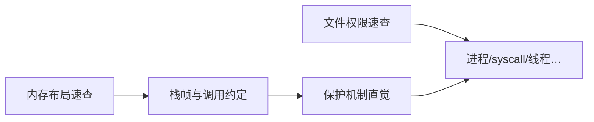

# Linux / 系统：学习路线与笔记地图

本主题收集 **Linux 用户态与相关系统知识**（进程地址空间、文件权限、工具链/保护机制、后续可扩进程/线程、系统调用等），与 `cpp/`、`graphics/`、`gpu/` 并列，在浏览页用 Topic 筛选。

> 定位：**速查 + 心智模型**。内存布局与权限模型可并行建立；再接到调试、安全防护与内核视角。正文以专业中文撰写；结构图用 Mermaid（浏览页渲染）。

## 建议路径

1. **进程虚存布局**：Text / Data / BSS / Heap / Stack——谁在高地址、谁向谁生长
2. **栈帧与寄存器**：一次函数调用在栈上与通用寄存器里留下什么
3. **越界与防护（学习向）**：缓冲越界如何破坏控制流直觉；ASLR、栈金丝雀等训练/编译标志作参考
4. **文件权限**：`ls -l`、`rwx`/八进制、SUID/SGID/Sticky——谁能读/写/穿越
5. **后续（规划）**：`/proc/<pid>/maps` 实读、系统调用边界、线程与 TLS、页表直觉、ACL/强制访问控制导论等

## 笔记地图

| 篇 | 主题 | 本库笔记 |
|----|------|----------|
| — | 路线与地图 | [00-roadmap](./00-roadmap.md) |
| 1 | 进程内存分段速查（已展开） | [memory-segmentation](./memory-segmentation-cheatsheet.md) |
| 2 | 文件权限速查（已展开） | [file-permissions](./file-permissions-cheatsheet.md) |

## 阅读约定

- 默认讨论 **用户态、常见 64 位 Linux / x86-64 System V ABI** 与 **POSIX 文件权限** 的教学模型；具体偏移、段名与 ACL/MAC 以本机工具与发行版文档为准。
- 「缓冲溢出」等安全相关内容只讲**结构与防护动机**，不提供可复现利用步骤。
- 代码块标 `c` / `bash` / `asm`；公式按需用 `$...$`。
