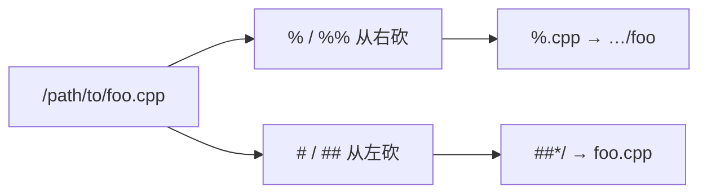

# Bash 参数扩展速查（删前后缀 / 替换 / 默认值 / 切片）

> **用途**：把 Bash **参数扩展（parameter expansion）** 的常用形态压成可检索 cheat sheet——删前/后缀、替换、缺省值、长度与切片、大小写变换。  
> **默认模型**：Bash 4+ 用户态交互/脚本；部分形态（如 `${var^^}`）在很老的 Bash / 严格 POSIX `sh` 中不可用。  
> **相关**：[本主题路线图](./00-roadmap.md) · [文件权限速查](./file-permissions-cheatsheet.md)

## 参考图


上图为整理好的参数扩展 cheat sheet 原图（站点内嵌，来源标注见原图）；下文用表格与示例做结构化对照。

## 一页总览

```mermaid
flowchart TB
  PE[参数扩展 ${...}] --> Def[缺省 / 赋值 / 错误]
  PE --> Cut[删前缀 / 后缀 % #]
  PE --> Sub[模式替换 /]
  PE --> Slice[切片与长度]
  PE --> Case[大小写变换]
```

| 家族 | 代表形态 | 一句话 |
|------|----------|--------|
| 缺省值 | `${FOO:-val}` / `:=` / `:+` / `:?` | 未设置（或空）时怎么取值 / 是否写回 / 是否报错退出 |
| 去后缀 | `${p%suf}` / `${p%%suf}` | 从**右**删最短 / 最长匹配 |
| 去前缀 | `${p#pre}` / `${p##pre}` | 从**左**删最短 / 最长匹配 |
| 替换 | `${p/pat/str}` / `//` / `/#` / `/%` | 首次 / 全部 / 仅前缀 / 仅后缀 |
| 长度 | `${#p}` | 字符长度（按 Bash 字符串规则） |
| 切片 | `${p:off:len}` | 从偏移取一段；负偏移从末尾计 |
| 大小写 | `${p,}` `${p,,}` `${p^}` `${p^^}` | 首字符或全部；Bash 4+ |

**速记**：`%` 盯右边（后缀），`#` 盯左边（前缀）；单符号非贪心，双符号贪心。

## 缺省值与「是否写回」

| 形态 | 当参数未设置或为空时 | 是否修改原变量 |
|------|----------------------|----------------|
| `${FOO:-val}` | 展开为 `val` | 否 |
| `${FOO:=val}` | 展开为 `val`，并把 `FOO` **设成** `val` | 是 |
| `${FOO:+val}` | （反过来）**仅当已设置且非空**时展开为 `val`，否则空 | 否 |
| `${FOO:?message}` | 打印 `message`（可含展开）并**非交互下退出** | — |

```bash
food=
echo "${food:-Cake}"    # Cake；food 仍为空
: "${food:=Cake}"       # 常用写法：只为赋值
echo "$food"            # Cake

unset NEED
echo "${NEED:?need it}" # 报错并退出（脚本中）
```

> 若开启 `set -u`，对未绑定变量的普通 `$FOO` 会失败；`${FOO:-}` 一类扩展常用来安全取值。

## 删前缀 / 删后缀

模式按 **路径名通配** 理解（`*` `?` `[…]`），不是正则。

| 形态 | 含义 |
|------|------|
| `${parameter%suffix}` | 去掉**最短**匹配的后缀 |
| `${parameter%%suffix}` | 去掉**最长**匹配的后缀 |
| `${parameter#prefix}` | 去掉**最短**匹配的前缀 |
| `${parameter##prefix}` | 去掉**最长**匹配的前缀 |

```bash
STR="/path/to/foo.cpp"

echo "${STR%.cpp}"   # /path/to/foo      去扩展名（最短后缀）
echo "${STR%/*}"     # /path/to          去掉最后一段路径
echo "${STR##*.}"    # cpp               取扩展名（最长前缀到最后一个 .）
echo "${STR##*/}"    # foo.cpp           basename
```



## 模式替换

| 形态 | 含义 |
|------|------|
| `${parameter/pattern/string}` | 只替换**第一次**匹配 |
| `${parameter//pattern/string}` | 替换**所有**匹配 |
| `${parameter/#pattern/string}` | 仅当 **pattern 匹配前缀** 时替换该前缀 |
| `${parameter/%pattern/string}` | 仅当 **pattern 匹配后缀** 时替换该后缀 |

```bash
STR="/path/to/foo.cpp"
echo "${STR/foo/bar}"   # /path/to/bar.cpp
echo "${STR//o/O}"      # /path/tO/fOO.cpp（示例：全部 o）
```

`string` 为空则表示删除匹配段：`${STR/foo/}`。

## 长度与切片

| 形态 | 含义 |
|------|------|
| `${#parameter}` | 长度 |
| `${parameter:offset}` | 从 `offset` 起到末尾 |
| `${parameter:offset:length}` | 从 `offset` 起取 `length` 个字符 |
| `${parameter: -n}` / `${parameter:(-n)}` | 负偏移：从末尾往前（注意空格或括号，避免被解析成 `:-`） |

```bash
name="John"
echo "${#name}"        # 4
echo "${name:0:2}"     # Jo
echo "${name:0:-1}"    # Joh（长度也可用负数，表示「去掉末尾若干」——视 Bash 版本）
echo "${name:(-2)}"    # hn
echo "${name: -2}"     # hn（冒号后空格很重要）

length=2
echo "${name:0:length}" # Jo（偏移/长度可以是算术表达式或变量）
```

## 路径拆解套路

```bash
SRC="/path/to/foo.cpp"
BASEPATH=${SRC##*/}          # foo.cpp
DIRPATH=${SRC%"$BASEPATH"}   # /path/to/
# 亦常用：
#   dirname 直觉 ≈ ${SRC%/*}
#   basename 直觉 ≈ ${SRC##*/}
```

## 大小写变换（Bash 4+）

| 形态 | 含义 |
|------|------|
| `${parameter,}` | 仅**第一个**字符转小写 |
| `${parameter,,}` | **全部**转小写 |
| `${parameter^}` | 仅**第一个**字符转大写 |
| `${parameter^^}` | **全部**转大写 |

```bash
STR="HELLO WORLD!"
echo "${STR,}"    # hELLO WORLD!
echo "${STR,,}"   # hello world!

STR="hello world!"
echo "${STR^}"    # Hello world!
echo "${STR^^}"   # HELLO WORLD!

ARR=(hello World)
echo "${ARR[@],}" # hello world
echo "${ARR[@]^}" # Hello World
```

对数组用 `"${ARR[@]…}"` / `"${ARR[*]…}"` 时，变换作用在每个元素上（注意 IFS 拼接差异）。

## 易错点

1. **`${var:-x}` 与 `${var: -1}`**：后者冒号后要空格（或写 `${var:(-1)}`），否则会走进「缺省值」语法。  
2. **`%` / `#` 不是正则**：是 glob；想按正则请用 `[[ =~ ]]` 或外部工具。  
3. **贪心 vs 非贪心**：`##` / `%%` 吃到最长；取扩展名常用 `##*.`，去一层目录常用 `%/*`。  
4. **引号**：含空格或 `*` 的结果务必 `"${…}"`，避免二次分词与路径名展开。  
5. **POSIX `sh`**：许多扩展是 Bash/ksh 超集；写 `#!/bin/sh` 脚本前先确认目标 shell。

## 练习指引

1. 对同一路径字符串，分别求出 dirname、basename、扩展名、无扩展名主名。  
2. 用 `${x:=}` 给可选环境变量填默认值，对比 `:-` 不写回的行为。  
3. 用 `${s// /_}` 把句子里所有空格换成下划线；再用 `/#` `/%` 只改头尾。  
4. 在 Bash 4+ 下练习 `${s,,}` / `${s^^}`，并在 `bash --posix` 或 `dash` 中观察哪些会失败。

## 小结

| 命题 | 一句话 |
|------|--------|
| `:-` `:=` `:+` `:?` | 缺省、写回、反向、报错四件套 |
| `%` `#` | 右删 / 左删；双写更贪心 |
| `/` `//` `/#` `/%` | 替换首次、全部、锚前缀、锚后缀 |
| `:off:len` `${#}` | 切片与长度；负偏移注意写法 |
| `,` `,,` `^` `^^` | Bash 4+ 大小写；可作用于数组元素 |
