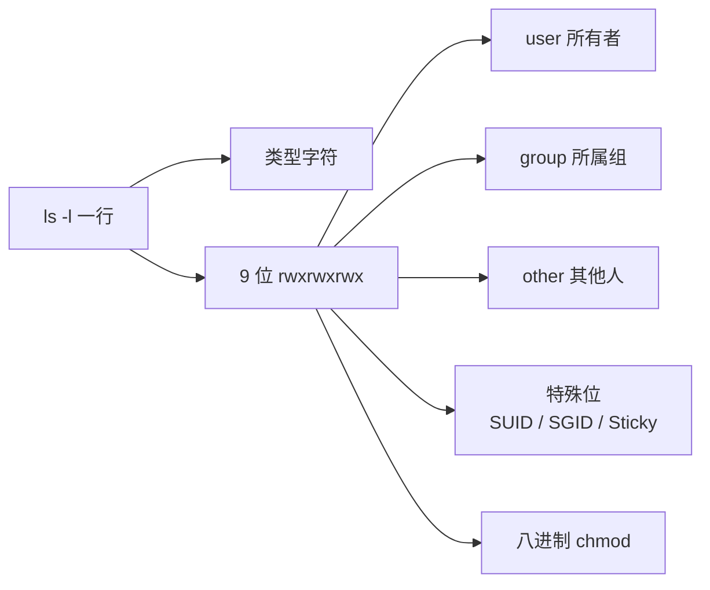
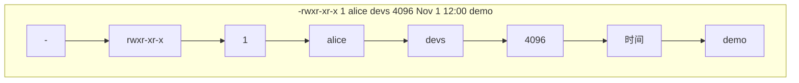
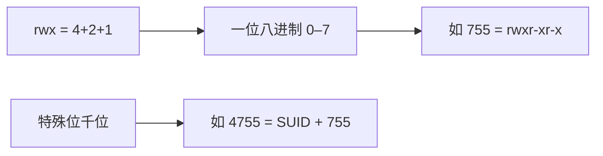
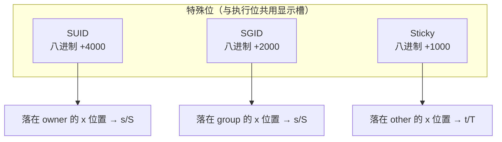
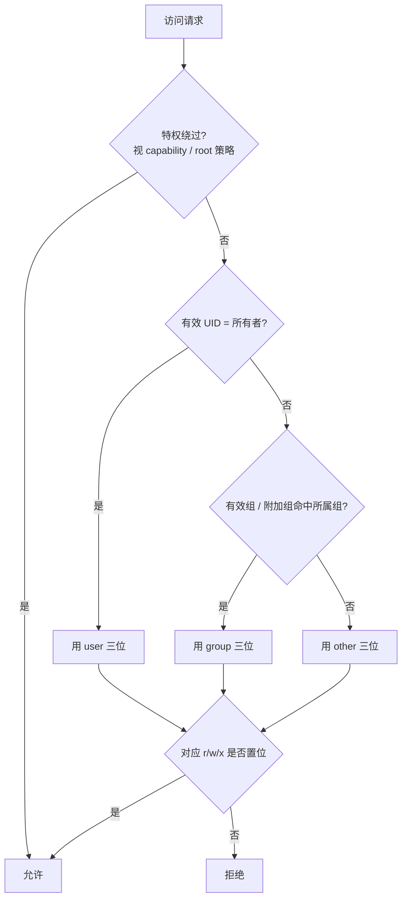

# 文件权限速查（ls -l / rwx / 八进制 / SUID·SGID·Sticky）

> **用途**：把 `ls -l` 一行权限串、`rwx` 与八进制、特殊位（SUID / SGID / Sticky）压成可检索 cheat sheet。  
> **默认模型**：常见 Linux 本地文件系统上的 **POSIX 权限**（owner / group / other）；ACL、SELinux、AppArmor、umask 细节另见扩展节。  
> **相关**：[本主题路线图](./00-roadmap.md) · [进程内存分段速查](./memory-segmentation-cheatsheet.md)

## 一页总览



| 对象 | 谁在比 | 三个字母各管什么（普通文件直觉） |
|------|--------|----------------------------------|
| **u** user | 有效 UID = 文件所有者 | `r` 读内容 · `w` 改内容 · `x` 当作程序执行 |
| **g** group | 有效 GID 属于文件所属组（且非所有者） | 同上 |
| **o** other | 其余进程 | 同上 |

**目录上的含义不同**（务必分开记）：

| 位 | 对**目录**的直觉 |
|----|------------------|
| `r` | 列出目录项（`ls` 需要；常还要 `x` 才能进入） |
| `w` | 在目录里创建 / 删除 / 重命名条目（改的是目录本身，不是子文件内容） |
| `x` | 穿越 / 进入（`cd`、用路径访问其下名字）；无 `x` 则路径走不通 |

## `ls -l` 拆解

示例行：

```text
-rwxr-xr-x  1 alice  devs  4096  Nov  1 12:00 demo
drwxr-x---  2 alice  devs  4096  Nov  1 12:00 src/
lrwxrwxrwx  1 alice  devs     8  Nov  1 12:00 link -> demo
```



| 字段（从左到右） | 含义 |
|------------------|------|
| 第 1 字符 | **文件类型**（见下表） |
| 第 2–10 字符 | 权限：`u` 的 `rwx` + `g` 的 `rwx` + `o` 的 `rwx` |
| 链接数 | 硬链接计数（目录通常 ≥ 2：`.` 与父目录中的名字） |
| 所有者 | user 名（或 UID） |
| 所属组 | group 名（或 GID） |
| 大小 | 普通文件字节数；目录常显示「目录项占用」而非树总大小 |
| 时间 | 默认多为 mtime（可用 `ls -l --time=...` 换） |
| 名字 | 最后一列；符号链接显示 `name -> target` |

### 类型字符速查

| 字符 | 类型 |
|------|------|
| `-` | 普通文件 |
| `d` | 目录 |
| `l` | 符号链接 |
| `c` | 字符设备 |
| `b` | 块设备 |
| `p` / `s` | FIFO / Unix domain socket |
| 其它 | 见 `info ls` / 文件系统特定类型 |

### 把 9 位拆开

```text
  rwx r-x r-x
  \_/ \_/ \_/
   u   g   o
```

| 位置 | 字母 | 有 / 无 |
|------|------|---------|
| 读 | `r` / `-` | 具备读 / 不具备 |
| 写 | `w` / `-` | 具备写 / 不具备 |
| 执行 | `x` / `-` | 具备执行 / 不具备（特殊位出现时可能显示为 `s`/`S`/`t`/`T`，见下文） |

## `rwx` ↔ 八进制

每一位是一个二进制权：`r=4`，`w=2`，`x=1`。三类人各一位八进制数字，拼成三位（常见）或四位（含特殊位）。



### 单组三位对照

| 八进制 | 二进制直觉 | 符号 |
|--------|------------|------|
| `0` | 000 | `---` |
| `1` | 001 | `--x` |
| `2` | 010 | `-w-` |
| `3` | 011 | `-wx` |
| `4` | 100 | `r--` |
| `5` | 101 | `r-x` |
| `6` | 110 | `rw-` |
| `7` | 111 | `rwx` |

### 常见三位模式

| 模式 | 符号（示意） | 典型用途直觉 |
|------|--------------|--------------|
| `755` | `rwxr-xr-x` | 可执行文件 / 目录：主人可写，其他人读+执行（穿越） |
| `644` | `rw-r--r--` | 普通文本/数据：主人可写，其他人只读 |
| `700` | `rwx------` | 私有目录或私有可执行 |
| `600` | `rw-------` | 私密文件（密钥、私钥类） |
| `711` | `rwx--x--x` | 目录：别人不能 `ls`，但知道名字时可穿越 |
| `555` | `r-xr-xr-x` | 只读树（部署产物等） |
| `000` | `---------` | 对「按权限检查的访问」全拒（root 等特权路径另论） |

```bash
chmod 644 file.txt
chmod 755 bin/tool
chmod u=rwx,g=rx,o=rx dir/     # 符号模式，等价思路于 755
chmod u+x script.sh            # 只给所有者加执行
chmod go-w file                # 去掉组与其他人的写
```

**心算**：`7=rwx`，`5=r-x`，`4=r--`，`6=rw-`；`755` = 主人全开，组/其他人读执行。

## 特殊位：SUID / SGID / Sticky

第四个八进制位（千位）编码三个特殊位；`ls -l` 用执行位字母的变形显示。



### 含义表

| 位 | 八进制 | 对**可执行文件** | 对**目录** |
|----|--------|------------------|------------|
| **SUID** | `4xxx` | 执行时有效 UID 变为**文件所有者**（经典例：历史语境下的 `passwd`） | 一般少用 / 行为因实现而异，勿当可移植工具 |
| **SGID** | `2xxx` | 执行时有效 GID 变为**文件所属组** | 新建子项默认继承**目录的组**（协作目录常用） |
| **Sticky** | `1xxx` | 现代 Linux 上对普通文件意义有限 / 历史遗留 | **只有所有者（或特权）可删/改名自己的条目**；`/tmp` 典型 |

### `ls -l` 显示：`s` / `S` / `t` / `T`

| 看见 | 含义 |
|------|------|
| `s`（在 u 或 g 的执行位） | 特殊位**开**，且对应 `x` **开** |
| `S`（同位置大写） | 特殊位**开**，但对应 `x` **关**（少见，常值得怀疑配置） |
| `t`（在 o 的执行位） | Sticky **开**，且 other 的 `x` **开**（如 `drwxrwxrwt` → `/tmp`） |
| `T` | Sticky **开**，other 的 `x` **关** |

```bash
# 示意（勿在生产乱给 SUID）
chmod 4755 tool          # SUID + rwxr-xr-x → -rwsr-xr-x
chmod 2755 shared_dir    # SGID 目录 → drwxr-sr-x
chmod 1777 /tmp/mydir    # Sticky + 777 → drwxrwxrwt
chmod u+s tool           # 符号方式开 SUID
chmod g+s collab/        # 目录开 SGID
chmod +t /tmp/mydir      # 开 Sticky
```

### 安全直觉（速查级）

- **SUID root 二进制**扩大攻击面：权限配置错误或漏洞的影响被放大。审计用 `find / -perm -4000` 一类命令前先确认自己有权限与范围。  
- **协作目录**：`2770` / `2775` + 正确组，比把目录 `777` 更清晰。  
- **`/tmp` 的 sticky**：防止用户互删文件；不等于「目录不可写」。

## 判定顺序心智模型

内核在做「这个进程能不能这样访问这个 inode」时，教学上可记：



要点：**命中所有者后只看 u 位**，不会「u 没有再回退到 g」。组没对上才看 o。

## `umask` 与新建默认权限

新建文件/目录的最终模式 ≈（类型默认值）去掉 umask 屏蔽位。

| | 常见默认起点 | 例：`umask 022` 后 |
|--|--------------|-------------------|
| 文件 | `666`（`rw-rw-rw-`） | `644` |
| 目录 | `777`（`rwxrwxrwx`） | `755` |

```bash
umask            # 查看（可能显示八进制或符号）
umask 027        # 新建更偏私密：文件常 640，目录 750
```

## 扩展与易混点

| 话题 | 一句话 |
|------|--------|
| **ACL**（`getfacl` / `setfacl`） | 在 u/g/o 之外加更细条目；`ls -l` 权限后出现 `+` |
| **符号链接权限** | 链接本身常显示 `rwxrwxrwx`；真正生效的是**目标**的权限与路径上各目录的 `x` |
| **改权限 vs 改所有者** | `chmod` 改模式；`chown` / `chgrp` 改所有者/组（常需特权） |
| **只改名字要有目录写权限** | 删除/重命名看的是**父目录**的 `w`（及 sticky 规则），不是文件自己的 `w` |
| **执行脚本** | 需要脚本文件 `x`（或显式 `interpreter script`），且路径上目录可穿越；shebang 指向的解释器也要可执行 |

## 练习指引

1. 对本目录 `ls -l`，口头拆出类型、三组 `rwx`、所有者/组。  
2. 把 `rw-r-----`、`rwxr-x---`、`rwsr-xr-x`、`drwxrwxrwt` 写成八进制。  
3. 建临时目录对比：`chmod 755` / `711` / `700` 下，「别人」对 `ls`、`cd`、已知文件名访问的差异。  
4. 在实验目录设 `chmod 2775` 与两名同组用户（或两终端切组），观察新建文件的组是否继承。  
5. `umask 022` 与 `umask 077` 下各 `touch` / `mkdir` 一次，对照结果。

## 小结

| 命题 | 一句话 |
|------|--------|
| `ls -l` | 类型 + 9 位权限 + 链接数 + 所有者 + 组 + … |
| `rwx` | 文件与目录语义不同；目录的 `x` 是穿越 |
| 八进制 | `r=4,w=2,x=1`；常见 `755`/`644`/`600` |
| 特殊位 | SUID/SGID/Sticky；看 `s/S/t/T`；目录 SGID 与 sticky 最常用 |
| 判定 | 先匹配 u，再 g，再 o；不「借用」下一档 |
