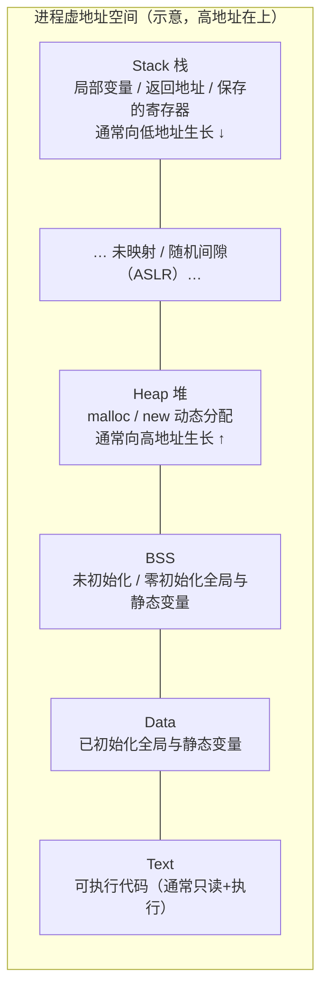
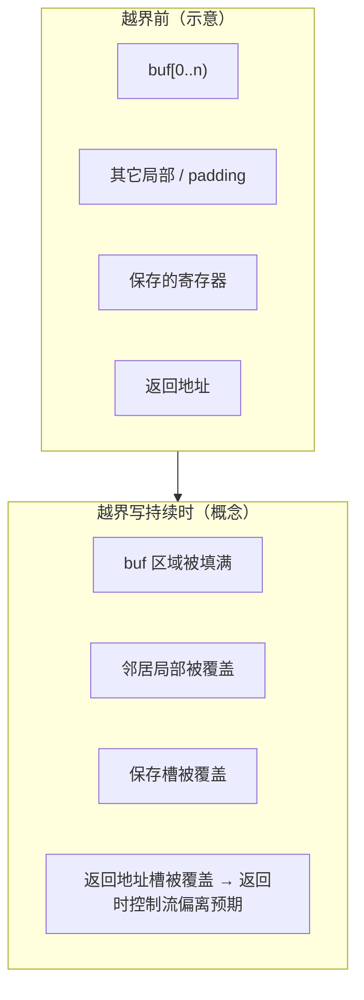

# 进程内存分段速查（Text / Data / BSS / Heap / Stack）

> **用途**：把「一个用户态进程的虚地址空间长什么样」压成一张可检索的 cheat sheet。  
> **范围**：布局、栈帧、常用寄存器角色、缓冲越界的**结构解剖（学习向）**，以及 ASLR / 栈保护等**训练与编译标志参考**。  
> **边界**：下文不提供可复现的利用链、shellcode 或绕过步骤；安全内容止于理解「为何会坏、防护在挡什么」。

相关：[本主题路线图](./00-roadmap.md)

## 一页总览

典型 **x86-64 Linux 用户态**教学模型（低地址 → 高地址；具体是否「栈在顶、堆向上」以平台与映射为准，下图为常见示意）：



| 区段 | 典型内容 | 生命周期直觉 | 常见权限直觉 |
|------|----------|--------------|--------------|
| **Text** | 机器码、只读常量字面量（视链接布局） | 随程序加载 | `r-x` |
| **Data** | 已初始化的全局/静态 | 进程级 | `rw-` |
| **BSS** | 未初始化或零初始化的全局/静态（文件中可不占空间） | 进程级，加载时清零 | `rw-` |
| **Heap** | `malloc` / `new` / 自定义分配器 | 显式申请与释放 | `rw-` |
| **Stack** | 调用帧：参数区、局部、返回地址等 | 随调用进出 | `rw-`（现代系统常 `NX`：不可执行） |

**速记口诀**：代码在 Text；带初值的全局进 Data；「声明了但没写初值」的全局进 BSS；运行时要多少拿多少走 Heap；函数一调一帧走 Stack。

```c
#include <stdlib.h>

int g_init = 42;      // Data
int g_bss;            // BSS（零初始化）
const char msg[] = "hi"; // 常落入只读数据 / 与 Text 相邻的 rodata

int main(void) {
  int local = 1;      // Stack
  int *p = malloc(16); // Heap（失败时需检查，此处从略）
  free(p);
  return local;
}
```

## 段与「链接视角」的对应

编译/链接阶段看到的名字，和运行时 `/proc/<pid>/maps` 里的映射并不总是一一同名，但心智模型可对齐：


| 链接/ELF 常见名 | 运行时角色 |
|-----------------|------------|
| `.text` | Text：指令 |
| `.rodata` | 只读数据，常与 Text 同属可读可执行映像的只读部分或独立 `r--` |
| `.data` | Data |
| `.bss` | BSS（文件尺寸可为 0，内存中占位） |
| （无固定 section） | Heap：`brk` / `mmap` 扩展 |
| （无固定 section） | Stack：主线程栈由内核/动态链接器安排；线程栈另论 |

自检命令（本机观察，结果因 PIE/ASLR 而变）：

```bash
readelf -S ./a.out | less          # section 头
readelf -l ./a.out | less          # program headers / PT_LOAD
cat /proc/self/maps                # 当前进程映射示意
```

## Heap 与 Stack：生长方向

教学上常画成：

- **Heap**：从低地址一侧**向高地址**延伸（`brk` 抬高 program break；大块也可能 `mmap`）。
- **Stack**：从高地址一侧**向低地址**延伸（`push` / 开辟帧时 `rsp` 减小）。


二者相向扩展时，逻辑上存在「撞上」的可能；现代系统靠 **空隙、资源限制（`ulimit`）、guard page** 等降低这种事故的现实概率。重点是：**不要假设「堆和栈之间是一片连续可写的安全空地」。**

## 栈帧（stack frame）速览

一次函数调用在栈上留下的「一帧」因 ABI、优化级别、是否帧指针而异。x86-64 System V 教学示意（高地址在上）：


调用过程的**结构顺序**（概念，非指令级教程）：

1. caller 按约定放置实参（部分进寄存器，其余进栈）。
2. `call`：把**返回地址**压栈，跳转到 callee。
3. callee 开栈：保存需要保留的寄存器，为局部变量留空间（`rsp` 下移）。
4. 函数体读写局部；若再调用其它函数，重复上述模式。
5. 返回：恢复保存内容，`ret` 弹出返回地址并跳回。

### 与局部缓冲的关系

```c
void demo(void) {
  char buf[32];   // 通常落在本帧的 Locals 区域
  // 向 buf 写入超过 32 字节且未做边界检查时，
  // 可能破坏同帧其它局部、保存的寄存器槽，乃至返回地址槽。
}
```

**学习要点**：缓冲在栈上是「一片连续字节」；**越界写**按地址递增/递减方向吞噬邻居——这是后面「越界解剖」的几何前提，不是教你如何构造攻击。

## 寄存器概览（x86-64 用户态直觉）

完整 ISA 远大于下表；此处只记**读栈与调用时最常对上号的名字**。

### 通用与指针

| 寄存器 | 速记角色 |
|--------|----------|
| `rax` | 返回值；部分系统调用号/返回 |
| `rdi` `rsi` `rdx` `rcx` `r8` `r9` | 前几个整数/指针实参（System V） |
| `rsp` | 栈顶指针；push/pop、开帧时变化 |
| `rbp` | 帧指针（`-fomit-frame-pointer` 时可能不用） |
| `rip` | 指令指针（不能当通用寄存器随意 mov 到任意值来「练习」；由控制流更新） |

### 调用约定一句话

- **callee-saved**（被调者负责还原）：如 `rbx`, `rbp`, `r12`–`r15`（具体以 ABI 为准）。
- **caller-saved**：调用前若仍需用，caller 自己保存。


ARM64 等架构名字不同（`sp` / `x0`…），但「参数寄存器 + 栈上帧 + 返回地址保存位置」的骨架同类。换架构时先查对应 ABI，不要硬套 x86 寄存器名。

## 缓冲越界：结构解剖（学习向）

### 想建立的直觉

栈上的 `char buf[n]` 没有内建「长度字段」。若把**未校验长度**的输入拷进 `buf`，多出来的字节会写到相邻内存。若相邻处恰好是**控制数据**（保存的寄存器、返回地址），程序的后续控制流可能不再回到 caller 的预期位置——轻则崩溃（segfault），重则行为完全失控。



### 应记住的分层，而非利用步骤

| 层次 | 理解目标 |
|------|----------|
| **缺陷** | 写越界：长度与目的地容量不匹配 |
| **后果** | 数据损坏 → 可能破坏控制数据 → 崩溃或异常控制流 |
| **工程响应** | 安全的 API 与边界检查、编译器防护、OS 随机化、不可执行栈等 |
| **分析响应** | 用调试器看帧与 maps；修根因，而不是「对准某个地址写什么」 |

**本笔记明确不覆盖**：构造恶意输入、跳板指令序列、绕过金丝雀/ASLR 的方法，或任何可复现的 exploit PoC。课堂若需演示，应在隔离实验环境使用教材提供的**已文档化实验架**，并遵循课程安全规范。

### 堆上的同类问题

Heap 上的越界同样会破坏相邻块元数据或邻居对象，表现为分配器断言、随机崩溃或逻辑错误。机理是「线性地址上的邻居被写坏」，与栈返回地址故事不同，但**根因仍是边界缺失**。

## 防护与训练标志参考

下列内容当作**词典**：看到标志或名词时知道它在挡哪一类事故。具体默认值随发行版与发行配置变化，以 `man gcc` / 发行版安全文档为准。

### OS / 运行时

| 机制 | 在挡什么（直觉） |
|------|------------------|
| **ASLR**（地址空间布局随机化） | 每次（或每进程）打乱栈/堆/库等基址，使「写死某个绝对地址」不可靠 |
| **NX / DEP**（不可执行栈/数据） | 数据页默认不可当代码执行，降低「在栈上放指令再跳转」的朴素路径 |
| **PIE**（位置无关可执行文件） | 主程序本身也可随机映射，与 ASLR 配套 |
| **RELRO**（部分/完全） | 降低 GOT 等重定位表被改写的窗口（链接/加载策略） |

查看示意：

```bash
# 内核 ASLR 档位（发行版只读策略可能禁止改）
cat /proc/sys/kernel/randomize_va_space
# 0 关闭；1 保守；2 常见的全随机（具体语义见内核文档）
```

### 编译器：栈保护与训练常用开关

| 标志 | 作用直觉 |
|------|----------|
| `-fstack-protector` / `-fstack-protector-strong` / `-fstack-protector-all` | 在帧里插入 **stack canary（金丝雀）**；返回前检查，发现栈被踩踏则中止 |
| `-fno-stack-protector` | **关闭**金丝雀；仅建议在受控教学实验中对比「有/无防护」的崩溃形态 |
| `-fPIE -pie` | 生成 PIE 可执行文件 |
| `-z execstack` | 标记栈可执行（旧式/实验）；现代默认通常相反 |
| `-z noexecstack` | 明确不可执行栈 |
| `-Wl,-z,relro,-z,now` | 更严的 RELRO（链接器） |
| `-g` | 调试信息，便于用 gdb/lldb 看帧，与「关防护」无关 |
| `-O0` | 少优化，帧形态更「教材」；优化会内联/消帧，观察时要心里有数 |

教学对比常用组合（**仅在自己的实验二进制上**）：

```bash
# 较易观察帧与局部布局的调试构建（仍保留常见发行版默认防护与否，视环境而定）
gcc -O0 -g -fno-omit-frame-pointer demo.c -o demo-dbg

# 显式打开较强栈保护（许多发行版工具链已默认 strong）
gcc -O2 -fstack-protector-strong demo.c -o demo-prot

# 受控对比：关闭栈金丝雀（不要用于生产）
gcc -O0 -g -fno-stack-protector demo.c -o demo-nossp
```

**训练纪律**：关 ASLR、关金丝雀只为在实验课上「看见」布局与帧；作业交回后应恢复默认加固。生产与公开二进制保持发行版默认安全编译选项。

## 与 C++ / 其它笔记的衔接

- 对象模型、`new`/`delete`、智能指针 → 仍主要落在 Heap / 生命周期纪律，见 `cpp/` 主题。
- GPU 显存层次是另一套空间，见 [`../gpu/gpu-memory-hierarchy.md`](../gpu/gpu-memory-hierarchy.md)；勿与进程 VA 混称「同一张图」。

## 易错点

1. **把 Data 和 BSS 当成 Heap**：全局/静态不在 `malloc` 里。  
2. **以为优化后栈帧长得和教材图一样**：`-O2` + 省略帧指针会让 `rbp` 画面消失。  
3. **把「崩溃」当成唯一后果**：越界也可能默默改数据，稍后才爆。  
4. **在公开环境关全防护练手**：泄漏的是习惯，不是技术深度。  
5. **32 位与 64 位、不同 ABI 混记寄存器与参数槽**。

## 练习指引

1. 写含全局初值、全局无初值、`malloc`、大数组局部变量的小程序，对比 `readelf -S` 与运行时 `pmap` / `/proc/self/maps`。  
2. 在 `-O0 -g -fno-omit-frame-pointer` 下用调试器单步 `call`/`ret`，对照 `rsp`/`rbp` 与局部地址。  
3. 分别用有/无 `-fstack-protector-strong` 的构建，对**故意写短的越界**（仍保持在实验程序内、不要构造利用）观察是否在返回前被金丝雀检出——目的是理解防护时机，不是绕过。  
4. 阅读 `man 3 malloc` 与本机 `ulimit -a`，把「堆限制 / 栈限制」和布局图对上号。

## 小结

| 命题 | 一句话 |
|------|--------|
| 五段式布局 | Text / Data / BSS / Heap / Stack 分工不同，生长方向不同 |
| 栈帧 | 返回地址与局部同台竞技；越界写先是几何问题 |
| 寄存器 | 记参数槽、`rsp`/`rbp`、返回值即可起步 |
| 安全学习 | 先懂损坏与防护动机；利用细节不属于本速查 |
| 标志 | ASLR / PIE / NX / stack-protector / RELRO 是词典条目，按场景查阅 |
