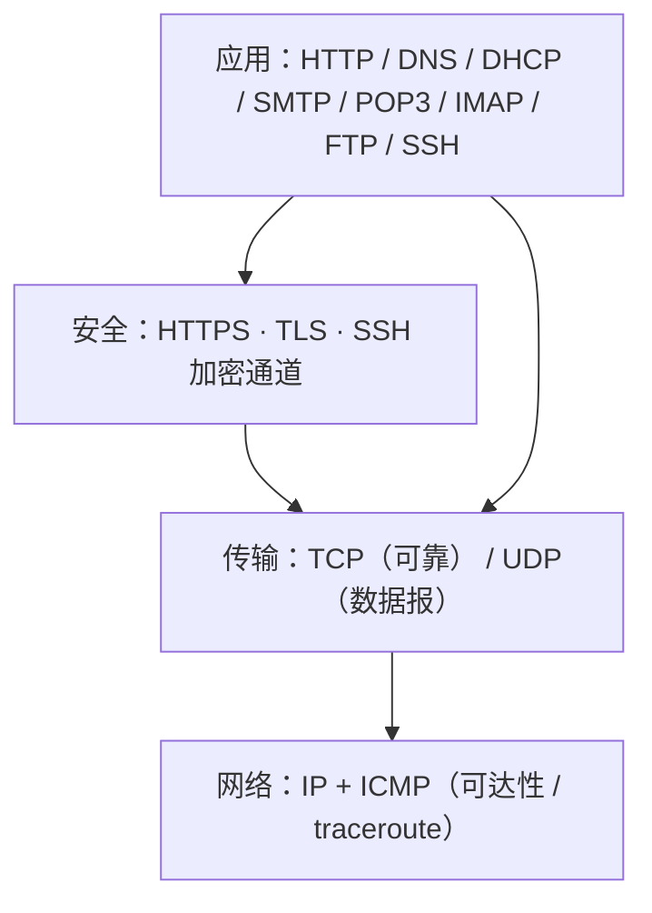

# 网络协议速览（HTTP 到 TLS）

> **用途**：把「点开一个网址 / 发一封邮件 / 登录一台机器」时，链路上常见协议叠成一张可检索的心智图。  
> **交互**：站内有完整中文 **[协议探索](#/protocols)** 演示（步进动画 + 报文表，约 14 种协议）；本笔记给文字骨架，细节以演示为准。  
> **边界**：教学示意地址与报文为虚构；不替代抓包与 RFC 原文。

相关：[本主题路线图](./00-roadmap.md) · 交互页 [`#/protocols`](#/protocols)

## 一页总览

| 协议 | 直觉角色 | 常见端口 | 传输 |
|------|----------|----------|------|
| HTTP | 明文 Web 请求/响应 | 80 | TCP |
| HTTPS | HTTP over TLS | 443 | TCP+TLS |
| TCP | 握手、序号、重传、挥手 | — | — |
| UDP | 无连接数据报 | — | — |
| IP | 寻址与逐跳转发（+NAT） | — | — |
| DNS | 名字 → 地址（可经根/TLD/权威） | 53 | UDP/TCP |
| DHCP | 自动拿地址与网关 | 67/68 | UDP |
| ICMP | ping / TTL 耗尽 / 不可达 | — | IP 封装 |
| SMTP | 发信与中继 | 465/587/25 | TCP(+TLS) |
| POP3 | 下载型收信 | 995 | TCP+TLS |
| IMAP | 服务器侧邮箱 + IDLE | 993 | TCP+TLS |
| FTP | 控制+数据双连接（明文风险） | 21+动态 | TCP |
| SSH | 加密远程壳与通道 | 22 | TCP |
| TLS | 握手与记录层机密性/完整性 | 依应用 | 常在 TCP 上 |

## 建议跟读路径

1. **DNS → TCP → HTTP**：对照协议探索里 HTTP 场景的报文表。
2. **同一路径加 TLS**：看 HTTPS / 独立 TLS 场景，分清「DNS 仍可能明文」与「应用数据已加密」。
3. **TCP vs UDP**：握手/重传 vs 直接发、丢了不补。
4. **IP + ICMP**：同网判断、ARP、NAT；ping 与 traceroute 的 TTL 技巧。
5. **邮件三件套**：SMTP 投递，POP3 拉走，IMAP 留在服务器。
6. **FTP vs SSH**：明文双连接 vs 加密会话通道。

在浏览页打开 **[协议探索 →](#/protocols)**，用「自动播放」走完每条场景；进度保存在本机 `localStorage`（可重置）。

## 与 Linux 笔记的交界

- 套接字、`/proc/net`、`ss`/`tcpdump` 等实操可后续单开笔记；本篇只建协议词汇表。
- 安全相关只讲结构与动机（例如 FTP 明文口令、TLS 证书校验），不提供攻击步骤。
