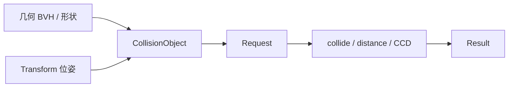

# FCL 邻近查询与宽阶段

> **出处**：[README · Interfaces](https://github.com/flexible-collision-library/fcl/blob/master/README.md)（改写）  
> **说明**：心智模型笔记，非逐段翻译；类型后缀 `f` / 模板参数以上游示例为准。Wiki 无对应页。

## 统一管线

几乎所有邻近查询都走同一套路：

1. 准备**几何**（mesh / 形状）与**位姿**（旋转 + 平移），合成 `CollisionObject`  
2. 填 **Request**（默认即可；需要接触信息再打开选项）  
3. 调用 `collide` / `distance` / `continuousCollide` 等  
4. 从 **Result** 读布尔结果、距离、接触等  



### 几何：mesh soup → BVH

README 示例用 `BVHModel<OBBRSSf>`：`beginModel` → `addSubModel(vertices, triangles)` → `endModel`。默认包围体模板是 OBBRSS 一类组合；细节见 Doxygen。

### 位姿：`Transform3f`

旋转矩阵 `R` + 平移 `T` 写入 `Transform3f`（`linear()` / `translation()`）。几何与位姿再交给 `CollisionObject`。

### 离散碰撞与距离

```cpp
CollisionRequest request;   // 默认：可只要布尔碰撞
CollisionResult result;
collide(o1, o2, request, result);

DistanceRequest dreq;
DistanceResult dres;
distance(o1, o2, dreq, dres);
```

需要接触点 / 法向时在 request 里打开对应选项——会更慢；只要「是否相交」就保持精简。

`CollisionRequest` 常见旋钮（见 `collision_request.h`）：`num_max_contacts`、是否返回 contact、cost source 相关开关、以及 **GJK solver 类型**（`gjk_solver_type`）。默认构造即可起步；要接触信息再打开。

### 连续碰撞（CCD）

物体上已有**起始**位姿；再提供各自**目标**位姿 `tf_goal_*`，走 `ContinuousCollisionRequest` / `Result` 与 `continuousCollide(...)`。直觉：在插值运动上找是否 / 何时首次接触。

## 宽阶段（Broadphase）

两组物体两两查会退化成 \(O(n^2)\)。FCL 用 **`BroadPhaseCollisionManager`** 挂接加速结构：

- 推荐实现名：README 写明 **`DynamicAABBTreeCollisionManager`** 通常性能最好  
- `registerObject` / `registerObjects` 注册；`setup()` 构建结构  
- 查询时提供 **callback** + **callback data**（库提供 `DefaultCollisionCallback` / `DefaultDistanceCallback` 及对应 Data）  

典型模式：组间碰撞 / 组间最小距离、组内自碰、单物体对一组。

## 上游样例入口

仓库 `test/`（名称以树内为准）：

- `test_fcl_collision.cpp` · `test_fcl_distance.cpp`  
- `test_fcl_broadphase.cpp` · `test_fcl_frontlist.cpp`  
- `test_fcl_octomap.cpp`（OctoMap 路径）

## 练习指引

1. 用两个盒子只做布尔 `collide`，再打开接触信息，感受 Result 字段变化。  
2. 同一对物体改用 `distance`，核对零距离与碰撞结果是否一致（数值容差）。  
3. 注册多物体到 `DynamicAABBTreeCollisionManager`，对比「暴力双循环」与宽阶段在物体数增大时的耗时量级。

返回：[概览](#/note/opensource/fcl/01-overview) · [路线](#/note/opensource/fcl/00-roadmap)
