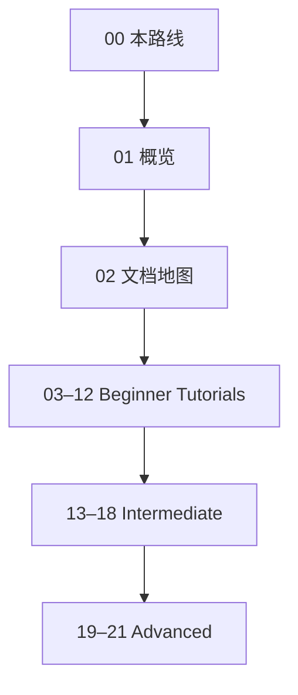

# OMPL 阅读路线

按上游 **Open Motion Planning Library** 整理的中文阅读架。规范仓库：[ompl/ompl](https://github.com/ompl/ompl)；文档站 [ompl.kavrakilab.org](https://ompl.kavrakilab.org)；许可证 **3-clause BSD**（Rice University，见上游 `LICENSE`）。

> **定位**：采样式运动规划的概念 + **官方 Tutorials 全量中文 digest**（非 Primer / Doxygen 镜像）。站内互链一律 `#/note/opensource/ompl/...`。

## Wiki / Tutorials 覆盖情况

| 项 | 状态（核查于 2026-11-08） |
|----|---------------------------|
| GitHub Wiki 开关 | 仓库 `has_wiki: false` |
| `/wiki` URL | **302** 回仓库主页（无 Wiki） |
| 可迁移 Wiki 页 | **0** |
| **Tutorials** | [tutorials.html](https://ompl.kavrakilab.org/tutorials.html) **Beginner / Intermediate / Advanced 全页**已迁为 03–21 digest；最优 / 约束 / 多层另含站内 high-level 导读要点 |
| 其它文档入口 | Installation / Planners / Spaces / API Overview / Primer PDF / Demos / FAQ |

本系列：**无 Wiki 页级 digest**；Tutorials 为官方难度分组的原创中文消化，代码标识对齐上游。

## 建议路径

1. [01 概览](#/note/opensource/ompl/01-overview) → [02 文档地图](#/note/opensource/ompl/02-docs-map)  
2. Beginner：SE(3) → 合法性 → 状态 →（可选）VAMP → 采样 / 可视化 / 基准 → 最优 / 约束 / 多层  
3. Intermediate：通用装配 → 新空间 / 目标 → ODESolver → 优化目标 / CForest  
4. Advanced：新规划器 → Python 绑定 → 投影  

## 章节地图

| 章 | 主题 | 笔记 | 上游 |
|----|------|------|------|
| 0 | 本路线 | 本页 | Tutorials 索引 / 仓库元数据 |
| 1 | 库概览 | [01](#/note/opensource/ompl/01-overview) | README |
| 2 | 文档站消化 | [02](#/note/opensource/ompl/02-docs-map) | 文档站导航 |
| 3 | 刚体 SE(3) 几何规划 | [03](#/note/opensource/ompl/03-geometric-planning-se3) | [geometricPlanningSE3](https://ompl.kavrakilab.org/geometricPlanningSE3.html) |
| 4 | 状态合法性 / 运动检查 | [04](#/note/opensource/ompl/04-state-validation) | [stateValidation](https://ompl.kavrakilab.org/stateValidation.html) |
| 5 | 状态与状态空间 | [05](#/note/opensource/ompl/05-working-with-states) | [workingWithStates](https://ompl.kavrakilab.org/workingWithStates.html) |
| 6 | VAMP 机械臂 | [06](#/note/opensource/ompl/06-vamp-planning) | [vampPlanningTutorial](https://ompl.kavrakilab.org/vampPlanningTutorial.html) |
| 7 | 合法状态采样器 | [07](#/note/opensource/ompl/07-samplers) | [samplers](https://ompl.kavrakilab.org/samplers.html) |
| 8 | 解路径可视化 | [08](#/note/opensource/ompl/08-path-visualization) | [pathVisualization](https://ompl.kavrakilab.org/pathVisualization.html) |
| 9 | 规划器基准 | [09](#/note/opensource/ompl/09-benchmark) | [benchmark](https://ompl.kavrakilab.org/benchmark.html) |
| 10 | 最优规划（含导读） | [10](#/note/opensource/ompl/10-optimal-planning) | [optimalPlanning](https://ompl.kavrakilab.org/optimalPlanning.html) + [Tutorial](https://ompl.kavrakilab.org/optimalPlanningTutorial.html) |
| 11 | 约束规划（含导读） | [11](#/note/opensource/ompl/11-constrained-planning) | [constrainedPlanning](https://ompl.kavrakilab.org/constrainedPlanning.html) + [Tutorial](https://ompl.kavrakilab.org/constrainedPlanningTutorial.html) |
| 12 | 多层规划（含导读） | [12](#/note/opensource/ompl/12-multilevel-planning) | [multiLevelPlanning](https://ompl.kavrakilab.org/multiLevelPlanning.html) + [Tutorial](https://ompl.kavrakilab.org/multiLevelPlanningTutorial.html) |
| 13 | 通用规划上下文 | [13](#/note/opensource/ompl/13-generic-planning) | [genericPlanning](https://ompl.kavrakilab.org/genericPlanning.html) |
| 14 | 实现新状态空间 | [14](#/note/opensource/ompl/14-implementing-state-spaces) | [implementingStateSpaces](https://ompl.kavrakilab.org/implementingStateSpaces.html) |
| 15 | 目标表示 | [15](#/note/opensource/ompl/15-goal-representation) | [goalRepresentation](https://ompl.kavrakilab.org/goalRepresentation.html) |
| 16 | ODESolver 控制规划 | [16](#/note/opensource/ompl/16-odesolver-controls) | [odeint](https://ompl.kavrakilab.org/odeint.html) |
| 17 | 自定义优化目标 | [17](#/note/opensource/ompl/17-optimization-objectives) | [optimizationObjectivesTutorial](https://ompl.kavrakilab.org/optimizationObjectivesTutorial.html) |
| 18 | CForest 并行最优 | [18](#/note/opensource/ompl/18-cforest) | [CForest](https://ompl.kavrakilab.org/CForest.html) |
| 19 | 添加新规划器 | [19](#/note/opensource/ompl/19-new-planner) | [newPlanner](https://ompl.kavrakilab.org/newPlanner.html) |
| 20 | 新规划器 Python 绑定 | [20](#/note/opensource/ompl/20-pybindings-planner) | [pybindingsPlanner](https://ompl.kavrakilab.org/pybindingsPlanner.html) |
| 21 | 投影 ProjectionEvaluator | [21](#/note/opensource/ompl/21-projections) | [projections](https://ompl.kavrakilab.org/projections.html) |

## 站内交叉

- 开源索引：[`#/opensource`](#/opensource)（按 `source: OMPL` 分组）  
- 阅读架总约：[opensource/00-roadmap](#/note/opensource/00-roadmap)  
- 碰撞检测搭档：[FCL 路线](#/note/opensource/fcl/00-roadmap)
