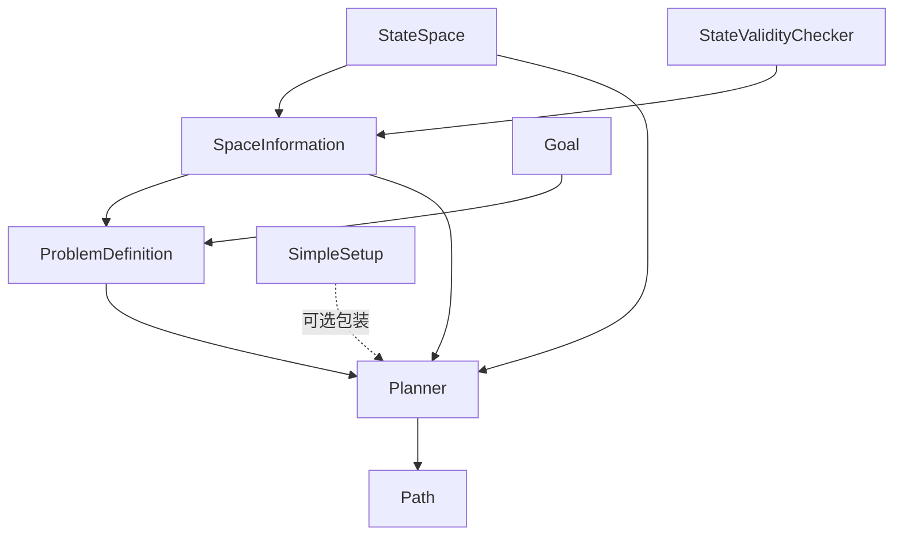

# OMPL 官方文档地图

> **出处**：[ompl.kavrakilab.org](https://ompl.kavrakilab.org) 导航（Installation / Planners / Spaces / Tutorials / API Overview 等）  
> **说明**：中文导读地图，**不是**文档站镜像；也**不是** GitHub Wiki（Wiki 未启用）。细节与包名随发行版变化，点进上游页核对。

## 安装入口（选一条路）

| 路径 | 直觉 |
|------|------|
| Ubuntu 脚本 / `apt` `libompl-dev` | 快；发行版包常**无** Python 绑定 |
| ROS 发行版里的 ompl 包 | 与 MoveIt 生态对齐；同样常无 Python 绑定 |
| 通用 Linux 源码 | Boost + CMake + Eigen；C++17；VAMP 需 git submodule |
| macOS MacPorts / Homebrew | 便捷；Homebrew 公式可能无 Python 绑定 |
| Windows vcpkg | `vcpkg install ompl`；通常无 Python 绑定 |
| CMake `FetchContent` | 嵌进其他工程时链 `ompl::ompl` |
| Python wheels / `pip` | 跟 README / 文档站当前说明走 |

官方安装长文：[Installation](https://ompl.kavrakilab.org/installation.html)（另有 `/core/installation.html` 变体，以站点菜单为准）。

## 规划器怎么分类

文档将实现分为三大块（名称以 [Available Planners](https://ompl.kavrakilab.org/planners.html) 为准）：

1. **Geometric**：只考虑几何 / 运动学可行；假定路径可再跟踪成动力学轨迹。内含多查询（PRM 族、SPARS…）、单查询树扩展（RRT 族、KPIECE…）、最优变体（RRT*、PRM*…）等。  
2. **Control-based**：带控制输入 / 传播模型。  
3. **Multilevel**：多层 / 抽象层次规划。

选型时先问：**只要几何路径，还是必须带控制？要可行解还是渐进最优？单次查询还是多次复用路图？**

## 状态空间速览

[Available State Spaces](https://ompl.kavrakilab.org/spaces.html) 常见积木：

- \(\mathbb{R}^n\)、SO(2)/SO(3)、SE(2)/SE(3)、Time、Discrete  
- Dubins / Reeds-Shepp 及若干 3D 扩展（UAV/UUV 向）  
- 特殊拓扑（Klein / Möbius / Sphere / Torus 等演示向）  
- **Constrained** 一族：投影、Atlas、Tangent bundle——配合约束规划文档  

复合空间用 `CompoundStateSpace` 思维：把关节角 + 底座 SE(2) 等拼起来。

## API 心智模型（Minimal）

[API Overview](https://ompl.kavrakilab.org/api_overview.html) 的用户侧骨架：

| 类 | 你要记住的一句话 |
|----|------------------|
| `StateSpace` | 拓扑：距离、插值、分配状态 |
| `StateValidityChecker` | 状态是否合法（常调碰撞） |
| `SpaceInformation` | 规划器常用例程的汇合点 |
| `ProblemDefinition` | 起点 + 目标 |
| `Planner` | 求解 |
| `SimpleSetup` | 少样板的装配层，不挡你深入 |

进阶还会碰到 `OptimizationObjective`、`ControlSpace` / `StatePropagator`、终止条件等——需要时再回文档站对应页。

## Tutorials 怎么刷

[Tutorials](https://ompl.kavrakilab.org/tutorials.html) 按难度分组；**站内已全量消化**为 [03–21](#/note/opensource/ompl/00-roadmap)：

1. Beginner：[03 SE(3)](#/note/opensource/ompl/03-geometric-planning-se3) → [04 合法性](#/note/opensource/ompl/04-state-validation) → [05 状态](#/note/opensource/ompl/05-working-with-states) →（可选）[06 VAMP](#/note/opensource/ompl/06-vamp-planning) → 采样 / 可视化 / 基准 → [10–12](#/note/opensource/ompl/10-optimal-planning) 最优·约束·多层  
2. Intermediate：[13–18](#/note/opensource/ompl/13-generic-planning)  
3. Advanced：[19–21](#/note/opensource/ompl/19-new-planner)  

另备：[OMPL Primer PDF](https://ompl.kavrakilab.org/OMPL_Primer.pdf)、[Demos](https://ompl.kavrakilab.org/demos.html)、[FAQ](https://ompl.kavrakilab.org/FAQ.html)。

## 练习指引

1. 用 `SimpleSetup` 跑通一个几何 demo，再故意换成另一种 geometric planner，只改规划器类型。  
2. 为同一 `SE3StateSpace` 问题写一个总是返回 `true` 的合法性检查，观察「无障碍」路径形态；再接上真实碰撞。  
3. 打开 Planners 页，给 PRM* 与 RRT* 各写一句「渐进最优」代价（时间 / 内存 / 参数敏感度）。

返回：[概览](#/note/opensource/ompl/01-overview) · [路线](#/note/opensource/ompl/00-roadmap)
