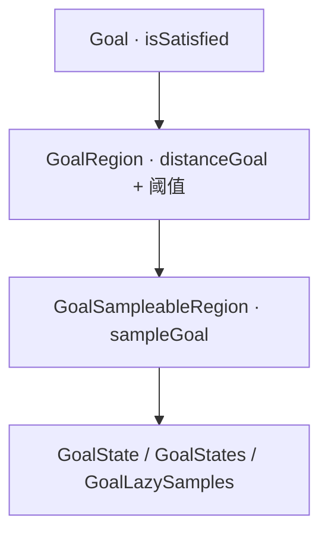

# 目标区域表示

> **出处**：[Tutorials · Representing goals](https://ompl.kavrakilab.org/goalRepresentation.html)

## 层级（信息越多越好）

### `Goal`

只实现 `isSatisfied(state)`。若有距离启发，再实现带 `double *distance` 的重载（默认距离为 `double` 最大）。

### `GoalRegion`

常见模式：距离 < 阈值即进目标。实现 `distanceGoal`；`isSatisfied` 已用阈值实现（默认阈值机器 epsilon，可用 `setThreshold`）。

### `GoalSampleableRegion`

双向规划器需要能从目标区采样：实现 `sampleGoal` + `maxSampleCount`；仍要实现 `distanceGoal`。双向规划连接树时调 `isStartGoalPairValid`（默认恒真），不一定再调 `isSatisfied`。

便利实现：

| 类 | 行为 |
|----|------|
| `GoalState` | 单目标态；采样总返回它；距离 = 空间距离 |
| `GoalStates` | 多目标；采样轮转；距离 = 到集合最小距离（线性扫描） |
| `GoalLazySamples` | 另线程采样（如 IK），规划同时往集合追加 |

单向前只要 `Goal`；双向需要至少 `GoalSampleableRegion`。解路径与近似标志写在 Goal 上，用其 accessor 查询。

## 练习指引

1. 把 `setStartAndGoalStates` 换成自定义 `GoalRegion`（阈值 0.1）。  
2. 双向规划器配 `GoalStates` 多目标，观察采样轮转。  

下一章：[ODESolver 控制规划](#/note/opensource/ompl/16-odesolver-controls)
